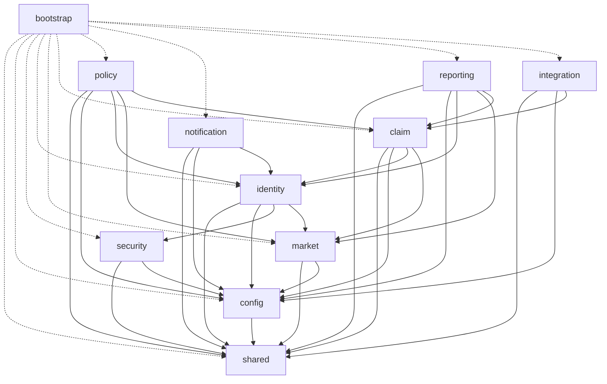
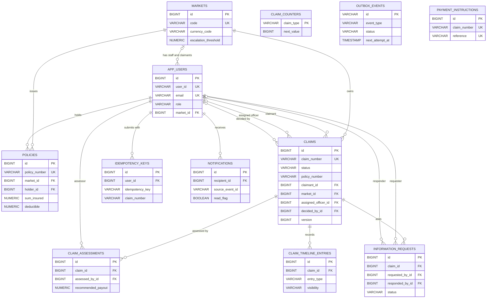
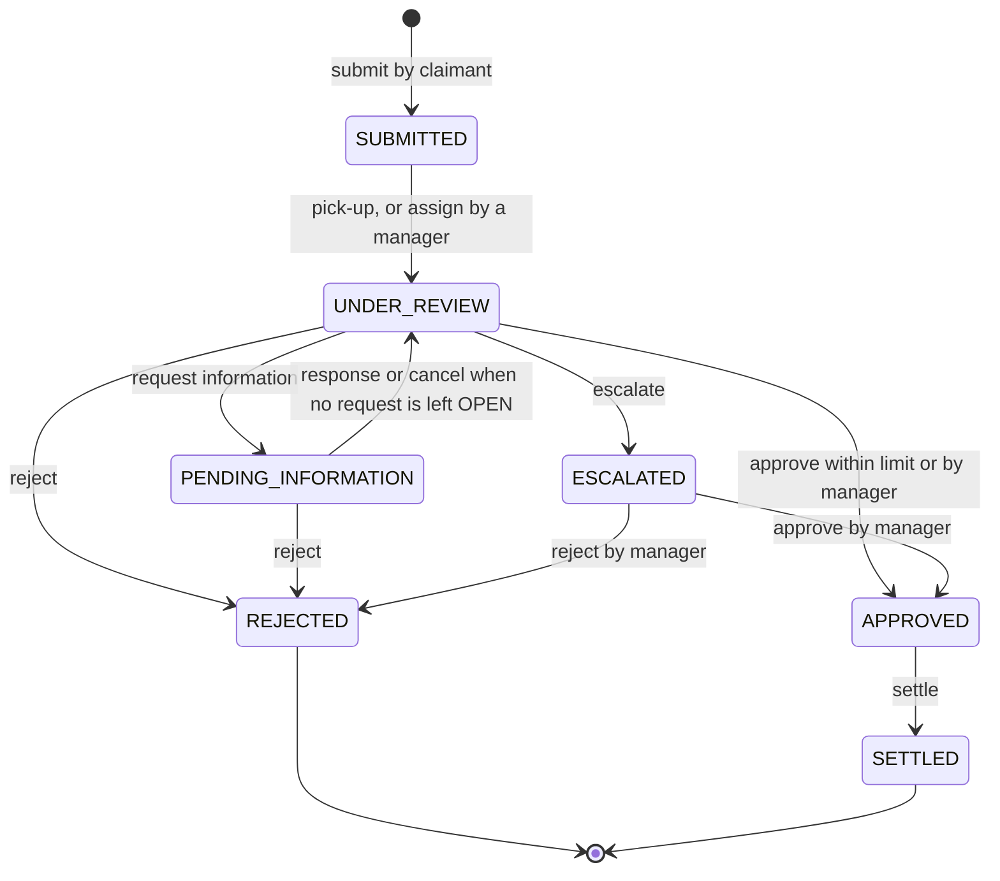
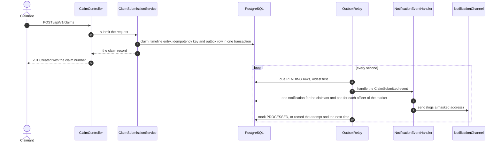
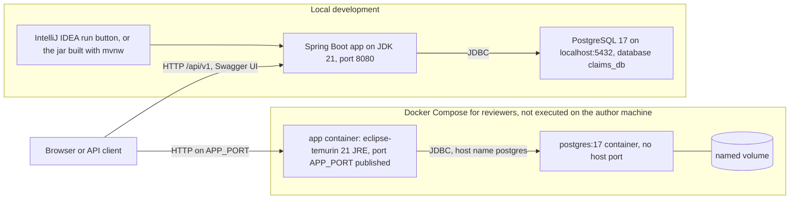

# Claims Management Platform

## Overview

**Pitch.** This is the backend for an APAC property and casualty insurer that handles motor and property claims in six markets (India, Singapore, Australia, Japan, Malaysia and Thailand). A claimant reports a loss and follows the claim to its outcome, claims officers work a queue through a defined workflow with an audit trail, and managers read live figures on outstanding claims and liability exposure. It is one Spring Boot application with enforced module boundaries, a PostgreSQL schema managed by Flyway, a transactional outbox for notifications, a simulated payment gateway behind a port, and an OpenAPI contract that a test keeps in step with the code.

**What each persona can do**

| Persona | Role | Features |
|---|---|---|
| Claimant | `CLAIMANT` | Register, log in, submit a motor or property claim against an own policy (safe to retry with an `Idempotency-Key`), list and open own claims, read the public timeline, answer an information request, read notifications and mark them as read |
| Claims officer | `OFFICER` | See the queue of the own market (oldest first, with age and SLA flag), pick up a claim, record an assessment (the system computes the deductible and the recommended payout), ask the claimant for information, escalate, approve within the market's limit, reject, settle, read policies of the own market, see the team's workload, performance, aging and overview |
| Manager | `MANAGER` | Everything an officer does in every market, without an approval limit; decide escalated claims, assign and reassign claims, create staff accounts, maintain policy reference data, read the liability exposure per market and in the base currency |

**Tech stack**

| Area | Choice |
|---|---|
| Language and build | Java 21, Maven (Maven Wrapper 3.9.11), Spring Boot 3.5.6 |
| Web and API | Spring Web, Bean Validation, springdoc-openapi 2.8.9 (Swagger UI), RFC 7807 errors |
| Security | Spring Security with the OAuth2 resource server (Nimbus JWT, HS256), BCrypt |
| Data | PostgreSQL 17, Spring Data JPA (Hibernate, `ddl-auto: validate`), Flyway migrations `V1` to `V6` |
| Tests | JUnit 5, Mockito, Spring Boot Test with MockMvc, H2 in PostgreSQL mode, ArchUnit 1.3.0, JaCoCo 0.8.12 |
| Packaging | `Dockerfile` (multi-stage) and `docker-compose.yml` with PostgreSQL 17 |

Not used, on purpose: a frontend, a message broker, Lombok, Testcontainers, file uploads ([what was left out and why](NOTES.md)).

**Criteria to evidence**

| Area | Where to look |
|---|---|
| Planning, Architecture and Design Thinking | [`docs/01-problem-analysis.md`](docs/01-problem-analysis.md) (problem, personas, scope, assumptions), [`docs/PLAN.md`](docs/PLAN.md) (delivery plan, risks, scope cuts), [`docs/02-architecture.md`](docs/02-architecture.md), 14 decision records in [`docs/adr/`](docs/adr/), [`NOTES.md`](NOTES.md), [`docs/requirements-traceability.md`](docs/requirements-traceability.md) (R1 to R13 to endpoints and tests) |
| Service and API Design | [`docs/04-api-design.md`](docs/04-api-design.md) (conventions, error contract, 36 operations), the controllers in the `api` packages under `src/main/java/com/apac/claims`, [`src/main/resources/openapi/claims-api.yaml`](src/main/resources/openapi/claims-api.yaml) and `OpenApiContractTest`, [ADR 0011](docs/adr/0011-api-versioning-error-contract-correlation-ids.md) |
| Clean Architecture and Engineering Discipline | Eleven modules and four layers enforced by 35 ArchUnit rules (`src/test/java/com/apac/claims/architecture`), [ADR 0001](docs/adr/0001-modular-monolith-with-enforced-module-boundaries.md), [ADR 0002](docs/adr/0002-pragmatic-hexagonal-layering.md), [ADR 0014](docs/adr/0014-api-records-and-kernel-api-in-the-layer-rules.md); constructor injection only, records for DTOs, Javadoc on every class, SLF4J only, one injected `Clock`; conventional commits (`git log --oneline`); the 75% coverage gate in `pom.xml` |
| Backend Test Automation | 82 test classes under `src/test/java` ([`docs/06-test-strategy.md`](docs/06-test-strategy.md)), `scripts/SmokeTest.java` and its recorded output [`docs/smoke-test-output.txt`](docs/smoke-test-output.txt), the JaCoCo gate, the contract test, the architecture tests |
| Data and Integration Implementation | Flyway migrations in `src/main/resources/db/migration`, [`docs/03-data-model.md`](docs/03-data-model.md), the outbox and its relay in the `integration` module, [`docs/05-integration-design.md`](docs/05-integration-design.md), the ports `PolicyLookup`, `PaymentGateway` and `NotificationChannel` with their adapters, ADRs [0005](docs/adr/0005-transactional-outbox-no-message-broker.md), [0006](docs/adr/0006-at-least-once-delivery-idempotent-consumers.md), [0008](docs/adr/0008-ports-and-adapters-for-external-integrations.md) |
| Backend Functional Completeness | Every requirement R1 to R13 in [`docs/requirements-traceability.md`](docs/requirements-traceability.md) is implemented with the test classes that cover it; the complete journey (submit, pick up, assess, ask for information, escalate, approve, settle, notify, report) is run end to end by the smoke script (165 steps, all passed on a fresh database) |

**Links**

| What | Link |
|---|---|
| Swagger UI | <http://localhost:8080/swagger-ui/index.html> |
| Swagger UI (short path) | <http://localhost:8080/swagger-ui.html> |
| OpenAPI JSON | <http://localhost:8080/v3/api-docs> |
| Health | <http://localhost:8080/actuator/health> |
| GitHub repository | `https://github.com/<your-username>/claims-management-platform` (replace the placeholder, see Setup) |
| Decisions and assumptions | [`NOTES.md`](NOTES.md) |
| Design documents | [`docs/`](docs/) |
| Architecture decision records | [`docs/adr/`](docs/adr/) |
| Prompts | [`prompts/`](prompts/) |
| AI journal | [`.claude/ai-journal.md`](.claude/ai-journal.md) |
| Interview guide | [`docs/INTERVIEW_GUIDE.md`](docs/INTERVIEW_GUIDE.md) |
| API contract | [`src/main/resources/openapi/claims-api.yaml`](src/main/resources/openapi/claims-api.yaml) |
| Smoke test output | [`docs/smoke-test-output.txt`](docs/smoke-test-output.txt) |

The links to `localhost` work while the application runs on port 8080.

## Architecture

**Style.** A modular monolith: one deployable (base package `com.apac.claims`), eleven modules that are first-level packages, boundaries checked by ArchUnit rather than by convention. A claim change, its timeline entry and its outbox event commit in one database transaction; a microservice split would have added failure modes the problem does not need ([ADR 0001](docs/adr/0001-modular-monolith-with-enforced-module-boundaries.md)). Full detail is in [`docs/02-architecture.md`](docs/02-architecture.md).

**Module and component graph.** An arrow means "may depend on". `claim` reaches policies, payments and notifications only through ports it owns and through shared event contracts; `policy` and `integration` implement those ports, which is why their arrows point at `claim`. The dotted arrows show that `bootstrap` (seeders and the root redirect) wires everything and nothing depends on it.



**Module dependency table.** Anything not listed is forbidden, and the graph has no cycles. `ModuleDependencyRulesTest` holds this table as data and fails on any other dependency.

| Module | Responsibility | May depend on |
|---|---|---|
| `shared` | Kernel: `ApiException` and the error codes, `PageResponse`, `MoneyRules`, event contracts, correlation id filter, the single exception handler | none |
| `config` | Typed configuration records, OpenAPI configuration, the `Clock` | shared |
| `security` | JWT issuing and decoding, filter chain, JSON 401 and 403 | shared, config |
| `identity` | Users, roles, login, registration | shared, config, security, **market** |
| `market` | The six markets: currency and escalation threshold | shared, config |
| `claim` | The core: submission, workflow, queue, assignment, assessment, information requests, decisions, settlement, timeline, claim numbers | shared, config, identity, market |
| `policy` | Policy reference data and the adapter for claim's `PolicyLookup` port | shared, config, identity, market, claim |
| `notification` | In-app notifications, event handler, channel port and logging email adapter | shared, config, identity |
| `reporting` | Overview, exposure, aging, workload, performance (read side) | shared, config, identity, market, claim |
| `integration` | Outbox write side and relay, simulated payment gateway | shared, config, claim |
| `bootstrap` | Composition root: demo data, sample claims, root redirect | every module; nothing depends on it |

The `identity` to `market` edge was added to the specification in prompt 3: a user's `market_id` is a foreign key to `markets`, and `market` depends only on `shared` and `config`, so it creates no cycle.

**Layer rules.** Inside each feature module the packages are `api`, `service`, `domain` and `infrastructure`.

| Layer | Contains | May depend on |
|---|---|---|
| `api` | Controllers and the request and response records (`api.dto`) | `service`, `domain` enums |
| `service` | Use cases (one public method is one transaction) and the ports to external systems | `domain`, other modules' `service` and `domain` types |
| `domain` | Entities, enums, rules, Spring Data repositories; no web types | `shared`, other modules' `domain` types |
| `infrastructure` | Adapters that implement ports | `service`, `domain` |

A module never uses another module's `api` or `infrastructure` package. Three named exceptions are written into the rules and explained in [ADR 0014](docs/adr/0014-api-records-and-kernel-api-in-the-layer-rules.md): a service may use the records of its own `api.dto`, every module may use the kernel `shared.api`, and `bootstrap` may use `claim.api.dto`.

**Entity relationships.** Only keys and the main columns are drawn; [`docs/03-data-model.md`](docs/03-data-model.md) has every column. A claim refers to its policy by `policy_number` (a value, not a foreign key), so `claim` does not depend on `policy`.



**Claim state machine.** The transition rules live in one pure class, `ClaimWorkflow`, with a unit test for every allowed and forbidden transition.



**From submission through the outbox to a notification.** The service writes the outbox row in the same transaction as the claim, so an event exists if and only if the change was committed. The relay delivers it afterwards (at least once), and the notification handler is idempotent.



**Local versus Docker deployment.**



**Main trade-offs**

| Decision | Gain | Cost |
|---|---|---|
| One deployable instead of services | One transaction per use case, no network failure modes, simple to run | Scaling is per application, not per module |
| Transactional outbox instead of a broker | No extra infrastructure; events cannot be lost or sent for a rolled-back change | One relay instance; delivery is at least once and handlers must be idempotent |
| Optimistic locking and an idempotency key | Races and retries are safe without long locks | A loser of a race gets a 409 and must retry |
| 404 instead of 403 for out-of-scope claims | The API does not reveal that a claim exists | A caller cannot tell "not yours" from "not there" |
| Reports computed live in memory | Always current, arithmetic unit-tested without a database | Work grows with the number of claims in scope |
| H2 in PostgreSQL mode for all tests | `mvnw -B clean verify` needs no Docker and no database | Behaviour that exists only on PostgreSQL is checked by hand, not by tests |
| Static illustrative exchange rates | Base-currency totals without a rate feed | Not accounting figures |

**Deliberately left out:** a frontend, file uploads (information responses are text), a message broker, real payment, policy and email systems (simulated behind ports), a real exchange-rate feed, claimant withdrawal. Reasons are in [`NOTES.md`](NOTES.md) and the [decision records](docs/adr/).

## Setup

### Prerequisites

- **JDK 21.** Check with `java -version`; it must print 21. Other JDKs on the PATH are not used by this project: set `JAVA_HOME` to the JDK 21 folder.
- **PostgreSQL 17** on `localhost:5432` with user `postgres` and password `postgres` (the defaults; change them with the variables below).
- Git. Docker is optional and only for the Compose route.
- No Maven installation is needed: the Maven Wrapper (`mvnw`) downloads Maven 3.9.11.

### One-time database step

Flyway creates the tables, but the database itself must exist. Create it once:

- **pgAdmin:** expand *Servers*, then your PostgreSQL 17 server, right-click *Databases*, choose *Create*, then *Database...*, type `claims_db` as the name and click *Save*.
- **Command line:** `psql -h localhost -U postgres -c "CREATE DATABASE claims_db;"`

### Three ways to run

Replace nothing below unless your PostgreSQL has other credentials. All three start on port 8080 and create the demo data (13 accounts, 13 policies and, on an empty database, four sample claims).

**1. IntelliJ IDEA run button.** Open the project folder, make sure the project SDK is JDK 21, open `ClaimsManagementPlatformApplication` (package `com.apac.claims`) and press the green run button next to `main`. This is the author's working route; it was not part of the automated final verification.

**2. Maven Wrapper (the route used for the final verification).** Build the jar, then start it:

```
export JAVA_HOME=/path/to/jdk-21
./mvnw -B -DskipTests package
java -jar target/claims-management-platform.jar
```

On Windows (PowerShell) the same steps are:

```
$env:JAVA_HOME = "C:\path\to\jdk-21"
.\mvnw.cmd -B -DskipTests package
java -jar target\claims-management-platform.jar
```

The jar was built and started this way against a fresh PostgreSQL 17 database: it started in 11.3 seconds, Flyway applied six migrations and the seeders created 13 users, 13 policies and 4 claims. `./mvnw spring-boot:run` runs the same application but was not used for the verification.

**3. Docker Compose.** The files are provided for a reviewer who has Docker. **They were written and reviewed line by line but never executed: Docker is not installed on the author's machine.**

```
docker compose up --build
```

This builds the image, starts `postgres:17` (no port published on the host, so it cannot clash with a local PostgreSQL) and starts the application once the database is healthy. Open <http://localhost:8080/swagger-ui/index.html>. Copy `.env.example` to `.env` only if you want other values. Stop with `docker compose down`; add `-v` to delete the database volume.

### Demo accounts

Created at start-up when `SEED_DEMO_DATA` is true (the default). All passwords are for local use only. In Swagger UI you choose the role from the dropdown and it must match the account's role.

| User id | Password | Role | Market |
|---|---|---|---|
| `manager.apac` | `Manager@123` | MANAGER | none (all markets) |
| `officer.in` | `Officer@123` | OFFICER | IN |
| `officer.sg` | `Officer@123` | OFFICER | SG |
| `officer.au` | `Officer@123` | OFFICER | AU |
| `officer.jp` | `Officer@123` | OFFICER | JP |
| `officer.my` | `Officer@123` | OFFICER | MY |
| `officer.th` | `Officer@123` | OFFICER | TH |
| `claimant.in` | `Claimant@123` | CLAIMANT | IN |
| `claimant.sg` | `Claimant@123` | CLAIMANT | SG |
| `claimant.au` | `Claimant@123` | CLAIMANT | AU |
| `claimant.jp` | `Claimant@123` | CLAIMANT | JP |
| `claimant.my` | `Claimant@123` | CLAIMANT | MY |
| `claimant.th` | `Claimant@123` | CLAIMANT | TH |

Each claimant holds a motor policy `MOT-<MKT>-0001` and a property policy `PRP-<MKT>-0001`, valid from one year before to one year after the first start (for example `MOT-IN-0001`). `claimant.in` also has a lapsed policy `MOT-IN-0002`, for trying the `POLICY_NOT_ACTIVE` error.

### Configuration variables

All are optional; the defaults suit a local run. The rates, SLA hours and relay settings are in `src/main/resources/application.yml`.

| Variable | Default | Meaning |
|---|---|---|
| `SERVER_PORT` | `8080` | Port of the application |
| `DB_HOST` | `localhost` | PostgreSQL host |
| `DB_PORT` | `5432` | PostgreSQL port |
| `DB_NAME` | `claims_db` | Database name |
| `DB_USERNAME` | `postgres` | Database user |
| `DB_PASSWORD` | `postgres` | Database password |
| `JWT_SECRET` | `dev-only-secret-change-me-0123456789abcdef` | Signing secret, at least 32 bytes (a shorter one stops the application at start-up). **Change it for anything that is not a local run** |
| `JWT_EXPIRY_MINUTES` | `120` | Token lifetime |
| `SEED_DEMO_DATA` | `true` | Create the 13 accounts and 13 policies when missing |
| `SEED_SAMPLE_CLAIMS` | `true` | Create the four sample claims, only when no claim exists |
| `APP_PORT` | `8080` | Docker Compose only: the port published on your machine |

### Troubleshooting

| Symptom | Cause and fix |
|---|---|
| The application stops at start-up with a PostgreSQL error that the database `claims_db` does not exist | Do the one-time database step above |
| `password authentication failed` for user `postgres` | Your PostgreSQL has another password: set `DB_USERNAME` and `DB_PASSWORD` |
| `Port 8080 was already in use` | Another program uses 8080: set `SERVER_PORT=8081` (Compose: `APP_PORT=8081`) and use that port in the links |
| Compile errors such as an unsupported release, or `java -version` is not 21 | A different JDK is on the PATH: set `JAVA_HOME` to JDK 21 and run `java -version` again |
| 401 | No token, a bad or expired token, or the account was deactivated: log in again, click Authorize and paste the token only |
| 403 | The token is valid but the role may not use the endpoint (for example a claimant on `/reports/overview`) |
| 404 | The resource does not exist **or is outside your scope**: the API does not tell the two apart. Claimants see only own claims, officers only their market |
| `docker` is not found | Docker is not installed: use the IntelliJ or `mvnw` route |
| Flyway reports a checksum mismatch or a failed validation | A migration that was already applied was edited. Applied migrations (`V1` to `V6`) must never change; on a local database with nothing to keep, drop and recreate `claims_db`, otherwise add a new migration |
| `GET /v3/api-docs.yaml` answers 401 | The public paths cover `/v3/api-docs/**`, so the JSON document at `/v3/api-docs` is open and the `.yaml` variant needs a bearer token |

### Push to GitHub

Replace `<your-username>` in this README first. Create an **empty** repository named `claims-management-platform` on GitHub (no README, no licence), then, in Git Bash inside the project folder:

```
git remote add origin https://github.com/<your-username>/claims-management-platform.git
git branch -M main
git push -u origin main
```

## API Reference

The interactive reference is Swagger UI. The committed contract is [`src/main/resources/openapi/claims-api.yaml`](src/main/resources/openapi/claims-api.yaml) (36 operations, exported from the running application; `OpenApiContractTest` fails if it and the live `/v3/api-docs` differ). The longer description with request and response examples is [`docs/04-api-design.md`](docs/04-api-design.md).

### Swagger walkthrough

Start the application on a fresh database and open <http://localhost:8080/swagger-ui/index.html>. The numbers below are the real ones observed on a fresh database: the seeder created four claims and the next new claims are `CLM-10003` and `CLP-10003`.

| Claim | Type and market | Amount | Status after start-up |
|---|---|---|---|
| `CLM-10001` | MOTOR, IN, `claimant.in` | INR 45000.00 | SUBMITTED (waiting in the queue) |
| `CLM-10002` | MOTOR, SG, `claimant.sg` | SGD 18000.00 | ESCALATED (`officer.sg` assessed it and handed it to a manager) |
| `CLP-10001` | PROPERTY, AU, `claimant.au` | AUD 6500.00 | UNDER_REVIEW (picked up by `officer.au`) |
| `CLP-10002` | PROPERTY, IN, `claimant.in` | INR 250000.00 (approved: 240000.00) | APPROVED (by `officer.in`, waiting for payment) |

1. **Log in.** Open `POST /api/v1/auth/login`. Choose the role in the dropdown (for example `CLAIMANT`), enter `{ "userId": "claimant.in", "password": "Claimant@123" }`, click *Execute* and copy `accessToken`. Click *Authorize* at the top, paste the token only (no `Bearer`) and confirm. A wrong user, password, inactive account or wrong role all give the same 401.
2. **Submit a claim** as `claimant.in`: `POST /api/v1/claims` with the MOTOR example, policy `MOT-IN-0001`, and an incident date from the last year. The answer is `201` with claim number `CLM-10003`. Sending the same `Idempotency-Key` again returns the same claim with `Idempotent-Replay: true`.
3. **Pick up** as `officer.in` (log in again, Authorize again): `GET /api/v1/claims/queue` lists `CLM-10001` and `CLM-10003`, oldest first. `POST /api/v1/claims/CLM-10003/pick-up` moves it to UNDER_REVIEW. A second officer racing for the same claim gets `409 CLAIM_ALREADY_ASSIGNED`.
4. **Assess:** `POST /api/v1/claims/CLM-10003/assessments`. The system computes the deductible and the recommended payout (`max(0, min(loss, sum insured) - deductible)` when coverage is confirmed).
5. **Ask for information:** `POST .../CLM-10003/information-requests` as the officer, then `POST .../information-requests/{requestId}/respond` as the claimant.
6. **Approve or escalate:** an officer approving more than the market's limit (INR 500000.00 in India) gets `422 APPROVAL_LIMIT_EXCEEDED`; `POST .../escalate` hands the claim to a manager.
7. **Decide and settle** as `manager.apac` (role MANAGER): `POST .../approve` (the body may be left out), then `POST .../settle` with `{ "paymentMethod": "BANK_TRANSFER" }`. The claim becomes SETTLED and carries a `paymentReference` such as `PAY-` plus 12 hexadecimal characters. You can do the same with the seeded claims: the manager approves the escalated `CLM-10002`, and `CLP-10002` (already APPROVED) can be settled at once.
8. **Notifications:** as `claimant.in`, `GET /api/v1/notifications` lists what happened to the claim (they are created by the outbox relay, so they appear after its next poll, every second by default, and not inside the request), `GET /api/v1/notifications/unread-count` counts them, `POST /api/v1/notifications/read-all` clears them.
9. **Reports** as `manager.apac`: `GET /api/v1/reports/overview`, `/exposure`, `/aging`, `/workload`, `/performance`. Exposure is shown per market in local currency and in USD with `rateSource` `STATIC_ILLUSTRATIVE`.

The longer demo script, with the order that tells the story, is in [`docs/INTERVIEW_GUIDE.md`](docs/INTERVIEW_GUIDE.md).

### Markets

| Code | Country | Currency | Decimal places | Officer approval limit (escalation threshold) |
|---|---|---|---|---|
| IN | India | INR | 2 | 500000.00 |
| SG | Singapore | SGD | 2 | 10000.00 |
| AU | Australia | AUD | 2 | 10000.00 |
| JP | Japan | JPY | 0 | 1000000 |
| MY | Malaysia | MYR | 2 | 25000.00 |
| TH | Thailand | THB | 2 | 200000.00 |

A claim takes the market and the currency of its claimant; there are no cross-currency claims. The threshold is in the market's own currency and the six values are roughly comparable in value.

### Claim numbers

`CLM-` plus a number for motor claims and `CLP-` plus a number for property claims, for example `CLM-10001` and `CLP-10001`. Each type has its own counter that starts at 10001. The counter row is locked, incremented and used in the same transaction as the claim insert, so the numbers are unique and a rolled-back submission leaves no gap. The API addresses claims by claim number and never exposes database ids.

### Workflow and business rules

| From | Action | To | Who |
|---|---|---|---|
| (none) | submit | SUBMITTED | claimant |
| SUBMITTED | pick-up | UNDER_REVIEW | officer or manager |
| SUBMITTED | assign | UNDER_REVIEW | manager (to an officer of the claim's market) |
| UNDER_REVIEW | request information | PENDING_INFORMATION | assigned officer or manager |
| PENDING_INFORMATION | response, or request cancelled, when none is left OPEN | UNDER_REVIEW | claimant or staff |
| UNDER_REVIEW | escalate | ESCALATED | assigned officer |
| UNDER_REVIEW | approve | APPROVED | assigned officer within the limit, or manager |
| UNDER_REVIEW, PENDING_INFORMATION | reject | REJECTED | assigned officer or manager |
| ESCALATED | approve or reject | APPROVED or REJECTED | manager only |
| APPROVED | settle | SETTLED | assigned officer or manager |

REJECTED and SETTLED are final. A manager can reassign a claim in UNDER_REVIEW, PENDING_INFORMATION or ESCALATED to another officer of the market without changing its status.

- **Submission.** The policy must exist and belong to the claimant, be active and cover the incident date, match the claim type and the claimant's market, and the claimed amount must not exceed the sum insured (all 422). The same policy, incident date and type is a 409 `DUPLICATE_CLAIM` unless the earlier claim was rejected. The incident date may be at most tomorrow in UTC and at most five years old. Exactly one block (`motor` or `property`) must match the claim type.
- **Assessment.** Recommended payout is `max(0, min(assessed loss, sum insured) - deductible)` if coverage is confirmed, otherwise 0.
- **Approval.** Needs a latest assessment with coverage confirmed and a payout above zero (409 `ASSESSMENT_REQUIRED`). The approved amount defaults to the recommended payout and cannot exceed it. An officer above the market's threshold gets 422 `APPROVAL_LIMIT_EXCEEDED`.
- **Settlement.** The payment gateway is called before anything is written; if it fails the answer is 502 and the claim stays APPROVED. The simulated gateway is idempotent by claim number, so a retry returns the same reference and never pays twice.
- **Scope.** A claimant sees own claims, an officer the claims of the own market, a manager all. Outside the scope a claim looks absent (404). Claimants never see assessments, internal timeline entries or staff user ids.
- **SLA** (calendar hours): first review within 48 hours of submission, decision within 240 hours.

### Endpoint summary

All paths are under `/api/v1` except `/actuator/health`. "Any" is any logged-in role. Every protected endpoint can also return 401. The catalogue with the full status codes is in [`docs/04-api-design.md`](docs/04-api-design.md).

| Method and path | Who | Statuses |
|---|---|---|
| `POST /auth/login?role=` | public | 200; 400; 401 (one message for every failure) |
| `POST /auth/register` | public | 201; 400; 409 `DUPLICATE_RESOURCE` |
| `GET /users/me` | any | 200 |
| `POST /users` | MANAGER | 201; 400; 403; 409 |
| `GET /users?role=&marketCode=&page=&size=&sort=` | MANAGER | 200; 400; 403 |
| `GET /markets`, `GET /markets/{code}` | any | 200; 404 |
| `GET /policies/mine` | CLAIMANT | 200; 403 |
| `GET /policies/{policyNumber}` | OFFICER (own market), MANAGER | 200; 403; 404 |
| `PUT /policies/{policyNumber}` | MANAGER | 201 on create, 200 on update; 400; 403 |
| `POST /claims` | CLAIMANT | 201; 200 with `Idempotent-Replay: true`; 400; 403; 409 `DUPLICATE_CLAIM`; 422 policy and amount rules |
| `GET /claims?status=&claimType=&marketCode=&assignedTo=&unassigned=&submittedFrom=&submittedTo=&page=&size=&sort=` | any | 200 (scoped by role); 400 |
| `GET /claims/queue` | OFFICER, MANAGER | 200 (SUBMITTED and unassigned, oldest first, `ageHours`, `slaBreached`); 403 |
| `GET /claims/{claimNumber}` | any | 200; 404 |
| `GET /claims/{claimNumber}/timeline` | any | 200 (a claimant gets PUBLIC entries only); 404 |
| `POST /claims/{claimNumber}/pick-up` | OFFICER, MANAGER | 200; 403; 404; 409 `CLAIM_ALREADY_ASSIGNED` or `CLAIM_INVALID_TRANSITION` |
| `POST /claims/{claimNumber}/assign` | MANAGER | 200; 400; 403; 404; 409; 422 (not an active officer of the market) |
| `POST /claims/{claimNumber}/assessments` | OFFICER, MANAGER | 201; 400; 403; 404; 409 |
| `GET /claims/{claimNumber}/assessments` | OFFICER, MANAGER | 200; 403; 404 |
| `POST /claims/{claimNumber}/information-requests` | OFFICER, MANAGER | 201; 400; 403; 404; 409 |
| `GET /claims/{claimNumber}/information-requests` | any | 200; 404 |
| `POST /claims/{claimNumber}/information-requests/{requestId}/respond` | CLAIMANT | 200; 400; 403; 404; 409 `INFORMATION_REQUEST_NOT_OPEN` |
| `POST /claims/{claimNumber}/information-requests/{requestId}/cancel` | OFFICER, MANAGER | 200; 403; 404; 409 |
| `POST /claims/{claimNumber}/escalate` | OFFICER | 200; 400; 403; 404; 409 |
| `POST /claims/{claimNumber}/approve` | OFFICER, MANAGER | 200; 400; 403; 404; 409 `ASSESSMENT_REQUIRED`; 422 `APPROVAL_LIMIT_EXCEEDED` |
| `POST /claims/{claimNumber}/reject` | OFFICER, MANAGER | 200; 400; 403; 404; 409 |
| `POST /claims/{claimNumber}/settle` | OFFICER, MANAGER | 200; 400; 403; 404; 409; 502 `PAYMENT_GATEWAY_UNAVAILABLE` |
| `GET /notifications?unreadOnly=&page=&size=` | any | 200 (own only) |
| `GET /notifications/unread-count` | any | 200 |
| `POST /notifications/{id}/read` | any | 200; 404 (also for another user's id) |
| `POST /notifications/read-all` | any | 200 |
| `GET /reports/overview` | OFFICER (own market), MANAGER | 200; 400; 403 |
| `GET /reports/exposure` | MANAGER | 200; 400; 403 |
| `GET /reports/aging` | OFFICER (own market), MANAGER | 200; 400; 403 |
| `GET /reports/workload` | OFFICER (own team), MANAGER | 200; 400; 403 |
| `GET /reports/performance?from=&to=&marketCode=` | OFFICER (own team), MANAGER | 200; 400; 403 |
| `GET /actuator/health` | public | 200 |

### Error contract

Every error is `application/problem+json` (RFC 7807) with a machine-readable `code`, a `timestamp` and a `correlationId` (the same id as the `X-Correlation-Id` response header and the log lines of the request). A validation failure adds `errors`, one entry per field; rejected values are never repeated.

```json
{
  "type": "about:blank",
  "title": "Bad Request",
  "status": 400,
  "detail": "Request validation failed",
  "instance": "/api/v1/claims",
  "code": "VALIDATION_FAILED",
  "timestamp": "2026-10-25T04:55:12.481Z",
  "correlationId": "5b0e5d6f-2f0c-4d0b-9d1c-7f7a1a0c9e11",
  "errors": [
    { "field": "claimedAmount", "message": "must be greater than 0" },
    { "field": "description", "message": "size must be between 10 and 1000" }
  ]
}
```

The 20 error codes are fixed by a test and listed in [`docs/04-api-design.md`](docs/04-api-design.md).

### Status code policy

| Situation | Status |
|---|---|
| No token, invalid, tampered, expired or foreign-issuer token; the token's user was deleted or deactivated (checked on every request) | 401 |
| Role not allowed for the endpoint, or an officer who is not the assignee acts on a claim | 403 |
| Unknown resource, or a resource outside the caller's scope | 404 (never 403, so existence is not revealed) |
| Invalid request (validation, malformed JSON, bad enum, bad parameter) | 400 |
| Business-rule violation | 422 |
| Invalid state transition, duplicate, concurrent modification | 409 |
| Upstream failure (payment gateway) | 502 |
| Unsupported method or media type | 405, 415 |
| Unexpected failure | 500 with the generic message "Unexpected error"; the stack trace goes to the log only |

## Testing

**How to run**

```
./mvnw -B clean verify                          # build, all tests, coverage report and gate
./mvnw -B test -Dtest=ClaimWorkflowTest         # one test class
java scripts/SmokeTest.java http://localhost:8080   # smoke test against a running instance
```

On Windows use `.\mvnw.cmd`. `JAVA_HOME` must point to JDK 21. The coverage report is `target/site/jacoco/index.html` after `verify`.

**Real results** (last full run against a fresh PostgreSQL database, JDK 21): `mvnw -B clean verify` is BUILD SUCCESS with **1396 tests, 0 failures, 0 errors, 0 skipped** (a parameterised test counts once per case), line coverage **95.58 percent** (2379 of 2489 lines; the gate is 75 percent) and **35 architecture rules**, all passing. The contract test (`OpenApiContractTest`, 2 test methods) was added after that run and passes on its own.

**Test pyramid.** The project has 82 test classes, all on H2 in PostgreSQL mode, so no Docker and no running PostgreSQL are needed:

| Level | Classes | What it proves |
|---|---|---|
| Unit | 43 | Rules in isolation: `ClaimWorkflow` (every allowed and forbidden transition), payout calculation, `MoneyRules`, the report calculators with a fixed clock, event envelopes, services with Mockito for ports |
| Repository | 3 | `@DataJpaTest` on the real Flyway migrations: constraints, queries, entities against the schema |
| Integration | 33 | `@SpringBootTest` with MockMvc through the real security chain: journeys, scope, 401, 403 and 404, validation, idempotency, real-thread races on pick-up, settlement and its failure, the relay and idempotent notifications, reports, the OpenAPI document and the contract |
| Architecture | 3 (35 rules) | `ModuleDependencyRulesTest` (module table, cycles, special module rules), `LayerRulesTest` (layers, entities, repositories, ports, `@PreAuthorize` on every protected path), `CodingRulesTest` (no field injection, no standard streams, no generic exceptions, no `javax`) |
| Smoke (outside Maven) | 1 script, 165 steps | `scripts/SmokeTest.java` against the running application and real PostgreSQL |

**Quality gates**

| Gate | Threshold | Enforced by |
|---|---|---|
| Build and tests | `mvnw -B clean verify` green on JDK 21 | Maven |
| Line coverage | At least 75 percent for the bundle, excluding request and response records, `config`, the main class and `package-info` | JaCoCo `check` in `pom.xml` |
| Test count | At least 80 test methods | There are 878 (annotation count of `src/test/java`) |
| Architecture | All 35 rules pass | ArchUnit tests, part of `verify` |
| Contract | The committed OpenAPI file and the live `/v3/api-docs` have the same paths and methods | `OpenApiContractTest` |

**Smoke script.** `scripts/SmokeTest.java` is a single-file Java program (`java scripts/SmokeTest.java [baseUrl]`). It prints PASS or FAIL for every step and exits with 1 on any failure. It checks health, login for each role, a wrong role, claim submission and the idempotent replay, scope and validation errors, the claims journey (pick-up, assessment, information request and answer, escalation, approval limit, manager approval, reject), settlement, notifications through the relay and the reports. On the fresh database it passed **165 of 165 steps in two consecutive runs**; the output of the second run is [`docs/smoke-test-output.txt`](docs/smoke-test-output.txt). The script creates users and claims in the database it runs against and there is no endpoint to delete them.

**Not tested, and why**

| Not tested | Reason |
|---|---|
| `Dockerfile` and `docker-compose.yml` by running them | Docker is not installed on the author's machine; the files were reviewed line by line and checked for consistency with `pom.xml` and `application.yml` |
| Behaviour that exists only on real PostgreSQL (lock timeouts, `SKIP LOCKED`, contention on the claim counter) | Tests use H2 in PostgreSQL mode; PostgreSQL 17 was exercised only by running the application and the smoke script sequentially |
| Several relay instances | The relay is a single instance by design |
| Real payment, policy and email systems | They are simulated behind ports; the tests cover the ports and the simulated adapters |
| Load and performance | No performance requirement exists |
| The IntelliJ run button and `spring-boot:run` | Not part of the automated checks |

## AI Journal and Prompts

The project was built with Claude Code (model `claude-sonnet-5-5`) working in the project folder, driven by **six staged prompts**: setup and design, data layer, security and identity, claims core, integration and reporting, and packaging and finish. Every prompt is saved verbatim in [`prompts/`](prompts/), in the order it was used, and [`prompts/README.md`](prompts/README.md) lists them with one line each, plus the one extra instruction that changed the work (stopping an unrequested defect check of the tests in prompt 4).

[`.claude/ai-journal.md`](.claude/ai-journal.md) records, per prompt and stage, the commands that were run, the real results, the problems and how they were fixed, the decisions with their reasons, what the assistant got wrong or retried, the limitations and the lessons learned. Nothing in a document is meant to claim more than a command or a test showed.

What the developer did: wrote and saved the six prompts, set the working rules, took the decisions the prompts keep for the developer (for example stopping the extra defect check, and resetting the local database before the final verification), and is responsible for the result. The journal lists what the developer should review personally (design documents, specification amendments, the exceptions in ADR 0014, the Docker files that could not be run); this README does not claim that this review has been done.
