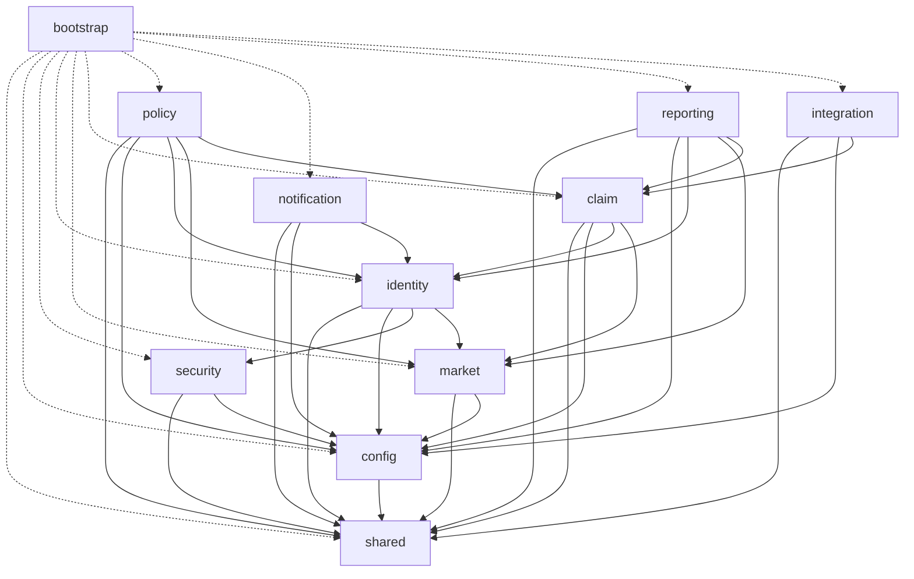
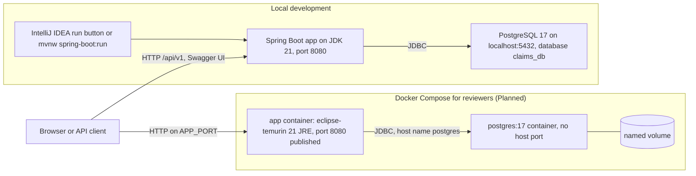

# 02. Architecture

Status: **Planned** (design only; every module below is marked Planned until the prompt that builds it completes).
Date: 2026-10-25. Source of truth: [PROJECT_SPEC.md](PROJECT_SPEC.md) sections 2, 3, 6, 8.

## 1. Architecture drivers and quality attributes

| Driver | Consequence for the design |
|---|---|
| Six markets, one team structure per market | Market is a first-class concept; scope rules (claimant, officer-by-market, manager-global) are enforced in services |
| Money and authority limits | Money is `NUMERIC(19,2)` with currency-specific decimal places; approval limits are checked in the service layer |
| Auditability | Every action writes a timeline entry; claims carry decision and settlement fields; events are persisted before delivery |
| Correctness under concurrency | Optimistic locking on claims, row-locked claim counters, idempotent submission and settlement |
| Replaceable external systems | Policy lookup, payment and notification channels sit behind ports |
| Reviewable by assessors | One deployable, boundaries checked by automated tests, no Docker needed to build or test |

Quality attributes, in priority order:

1. **Correctness and auditability.** A decision must be explainable from the timeline and the stored fields.
2. **Security.** No claim data leaks across roles or markets; out-of-scope resources look absent (404).
3. **Maintainability.** Modules with explicit dependencies; rules enforced by ArchUnit rather than convention.
4. **Testability.** All tests run on H2 in PostgreSQL mode without Docker.
5. **Operability.** Health endpoint, correlation id on every request, configuration through environment variables.
6. **Performance and scale.** A secondary concern: one instance is expected to be enough; the design records how it would scale (section 10).

## 2. Architectural style: modular monolith

The system is **one deployable** (a single Spring Boot application, base package `com.apac.claims`) split into **eleven modules** that are first-level packages. Boundaries are explicit and are enforced by ArchUnit tests, not by Maven sub-modules.

Why a modular monolith rather than microservices or one undivided package:

- The domain is small and strongly consistent: a claim change, its timeline entry and its outbox event must commit together. A single database transaction gives that for free.
- Microservices would add network failure modes, distributed transactions and deployment effort that the problem does not need.
- An undivided package would let any class call any other, and the dependency structure would erode. Explicit modules with a checked dependency table keep the later option of splitting by module open (section 10).
- See [ADR 0001](adr/0001-modular-monolith-with-enforced-module-boundaries.md).

## 3. Module responsibilities

| Module | Responsibility | Status |
|---|---|---|
| `shared` | Kernel: `ApiException` base class (error code and HTTP status), error codes, `PageResponse`, `MoneyRules`, domain-event contracts (`DomainEvent`, `DomainEventPublisher`, `DomainEventHandler`), correlation id filter, and the single `GlobalExceptionHandler` in `shared.api` | Planned |
| `config` | `@ConfigurationProperties` records and OpenAPI configuration | Planned |
| `security` | JWT issuing and decoding, security filter chain, JSON 401 and 403 handlers. Depends on no feature module | Planned |
| `identity` | Users, roles, login, registration, current-user resolution, adapter from users to Spring's `UserDetailsService` | Planned |
| `market` | The six markets: country, currency, escalation threshold | Planned |
| `policy` | Policy reference data (a local snapshot standing in for the policy administration system) and the adapter that implements claim's `PolicyLookup` port | Planned |
| `claim` | Core: first notice of loss, workflow, queue and pick-up, assignment, assessment, information requests, decisions, settlement, timeline, claim numbers | Planned |
| `notification` | In-app notifications, event handlers, `NotificationChannel` port and the logging email adapter | Planned |
| `reporting` | Workload, performance, aging, exposure, overview (read side) | Planned |
| `integration` | Transactional outbox, relay, payment gateway adapter | Planned |
| `bootstrap` | Composition root: demo-data `DataInitializer` and the root redirect controller (`bootstrap.api`). Nothing depends on it | Planned |

## 4. Allowed module dependencies

Anything not listed is forbidden, and the graph has no cycles.

| Module | May depend on |
|---|---|
| shared | none |
| config | shared |
| security | shared, config |
| identity | shared, config, security, market (see the note below the graph) |
| market | shared, config |
| claim | shared, config, identity, market |
| policy | shared, config, identity, market, claim (implements claim's `PolicyLookup` port) |
| notification | shared, config, identity |
| reporting | shared, config, identity, market, claim |
| integration | shared, config, claim (implements claim's `PaymentGateway` port; dispatches shared events) |
| bootstrap | every module (it only wires and seeds); nothing depends on it |

The dotted edges show that `bootstrap` depends on every module. It is the composition root; nothing depends on it.

**Clarification found in prompt 2, amended in the specification in prompt 3.** The first version of the specification's table listed `identity` as depending on `shared`, `config` and `security` only. The data layer needs one more edge, `identity` to `market`: `app_users.market_id` is a foreign key to `markets`, so `AppUser` holds an association to `Market`, and both registration and login work with market codes. The edge creates no cycle, because `market` depends only on `shared` and `config`. `docs/PROJECT_SPEC.md` now has the same row, and the architecture tests written in later prompts must allow this edge.

Cross-module rules that the table does not show:

- A module may use another module's `service` classes and `domain` types, never its `api` or `infrastructure` packages.
- `claim` must not depend on `policy`, `notification`, `reporting` or `integration`. It reaches them only through ports it owns and through the shared event contracts. The arrows from `policy` and `integration` to `claim` are dependency inversion: those modules implement `claim`'s ports.
- `security` depends on no feature module. `identity.infrastructure.AppUserDetailsService` adapts users to Spring's `UserDetailsService`, and `identity.service.AuthService` calls the token issuer in `security` with plain values (user id, role name, market code).

## 5. Layer rules inside a feature module

| Layer (package) | Contains | May depend on |
|---|---|---|
| `api` | Controllers, request and response records | `service`, and `domain` enums that appear in DTOs |
| `service` | Use-case services (transaction boundaries, orchestration, scope checks) and the **ports** to external systems | `domain`, other modules' `service` and `domain` types |
| `domain` | Entities, enums, domain rules, Spring Data repository interfaces (treated as persistence ports, a documented pragmatic choice). No web or servlet types | `shared` and other modules' `domain` types (for example an entity association to a user); never `org.springframework.web`, `jakarta.servlet`, or any `api`, `service` or `infrastructure` package |
| `infrastructure` | Adapters that implement ports, plus framework wiring | `service` (ports), `domain` |

Rules that follow: entities never leave the service layer (services map them to DTOs inside the transaction); controllers are `@RestController` classes in `..api..` named `*Controller`; constructor injection only. See [ADR 0002](adr/0002-pragmatic-hexagonal-layering.md).

## 6. Communication styles

| Style | Used for | Mechanism |
|---|---|---|
| Synchronous | Client to platform | REST/JSON under `/api/v1` |
| Synchronous, in-process | Module to module | Calls to another module's `service` classes, and to ports |
| Asynchronous | Reacting to claim changes (notifications) | Domain event written to the `outbox_events` table in the same transaction as the state change, then delivered by a scheduled relay to `DomainEventHandler` beans. At-least-once; handlers are idempotent |
| Ports and adapters | External systems | `PolicyLookup`, `PaymentGateway`, `NotificationChannel`, each with one simulated adapter |

Details are in [05-integration-design.md](05-integration-design.md).

## 7. Security architecture

- **Authentication.** `POST /api/v1/auth/login?role=` takes a user ID, password and a role. Every failure (unknown user, wrong password, inactive account, wrong role) returns the same 401 message so that account existence is not revealed. Passwords are stored as BCrypt hashes (8 to 64 characters, at least one letter and one digit).
- **Tokens.** Stateless JWT signed with HS256 using a shared secret of at least 32 bytes; the application fails at startup if the secret is shorter. Claims: `iss`, `sub` (user id), `iat`, `exp`, `role`, and `market` when present. The decoder is explicitly set to HS256. See [ADR 0004](adr/0004-stateless-jwt-hs256-role-selected-at-login.md).
- **Filter chain.** `SecurityFilterChain` with `requestMatchers`, stateless sessions, CSRF disabled (token API), `@EnableMethodSecurity` and `@PreAuthorize` on controller methods. Public paths: `/`, `/api/v1/auth/**`, Swagger UI and API docs, `/actuator/health`, `/error`.
- **Authorization.** Two layers. Role checks are declarative on controllers (`@PreAuthorize`, giving 403). Business-scope checks live in services: a claimant sees only own claims, an officer only claims of their market, a manager everything. An out-of-scope or unknown resource returns **404**, never 403, so existence is not revealed.
- **Current user.** On each request the user is loaded from the database by `sub`; a missing or inactive user gets 401.
- **Failure responses.** `RestAuthenticationEntryPoint` (401) and `RestAccessDeniedHandler` (403) write the same RFC 7807 JSON shape as every other error.
- **Data handling.** Logs carry user ids and claim numbers only, never passwords, tokens or other personal data. No secrets are committed other than documented local-development defaults; real values come from environment variables.

## 8. Observability

| Aspect | Design |
|---|---|
| Correlation id | `X-Correlation-Id` is read from the request or generated, placed in the logging MDC, returned in the response header and included in every error body |
| Logging | SLF4J only; the log pattern includes `%X{correlationId}`; no standard streams, no `java.util.logging` |
| Health | `GET /actuator/health` is public; `info` is also exposed; nothing else |
| Outbox visibility | Event status, attempts and last error are stored in `outbox_events`, so a failed delivery can be diagnosed with a query |
| Not included | Metrics registry, tracing backend and alerting. They would be added at deployment time |

## 9. Deployment view

- **Local.** The developer runs the application from IntelliJ IDEA or with `mvnw`, against a PostgreSQL 17 instance whose database `claims_db` is created once by hand. Flyway creates the schema at startup; `DataInitializer` seeds demo data.
- **Docker Compose.** A multi-stage `Dockerfile` builds the jar with Maven on JDK 21 and runs it on a JRE image as a non-root user. `docker-compose.yml` starts PostgreSQL 17 (no published host port, a named volume, a `pg_isready` health check) and the application, which waits for a healthy database. Docker is **not installed on the development machine**, so these files are reviewed by reading and are not executed there.
- **Configuration.** Environment variables with safe local defaults: `SERVER_PORT`, `DB_HOST`, `DB_PORT`, `DB_NAME`, `DB_USERNAME`, `DB_PASSWORD`, `JWT_SECRET`, `JWT_EXPIRY_MINUTES`, `SEED_DEMO_DATA`, `SEED_SAMPLE_CLAIMS`.
- **Tests** use H2 in PostgreSQL mode and need neither PostgreSQL nor Docker.

## 10. How this would evolve

| Pressure | Step | Why the design allows it |
|---|---|---|
| A module needs independent scaling or a separate team | Split the module into its own service | Modules already talk through `service` calls, ports and events; tables are owned per module and there are no foreign keys across modules except to `app_users` and `markets`. Cross-module calls would become HTTP or events |
| Several consumers or other systems need claim events | Add a message broker | The seam is the outbox relay: replace its in-process dispatch to `DomainEventHandler` beans with a publish to a broker topic, and mark the row `PROCESSED` after the broker acknowledges. Services keep calling `DomainEventPublisher` and do not change. Consumers already deduplicate by event id |
| More than one application instance | Make the relay safe to scale out | Today the relay is a single instance. Selecting rows with `FOR UPDATE SKIP LOCKED` lets several relays share the table |
| Real policy or payment systems | Replace the adapters | `PolicyLookup` and `PaymentGateway` are ports owned by `claim`; only the adapter classes change |
| Attachments | Add a storage port in `claim` | Information responses are text-only today ([ADR 0013](adr/0013-text-only-information-responses.md)) |
| Heavier reporting load | Add caching or a read replica | Reports are computed live today, with no cache, behind the `reporting` module |
