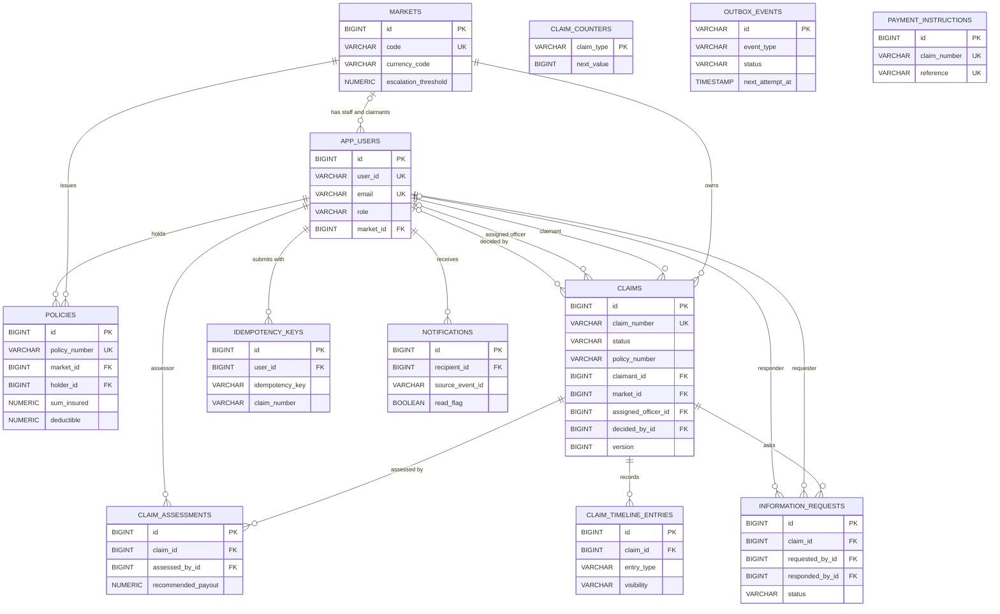

# 03. Data Model

Status: **Planned** (the Flyway migrations are written in the data-layer prompt; this document is the design they implement).
Date: 2026-10-25. Source of truth: [PROJECT_SPEC.md](PROJECT_SPEC.md) section 4.

## 1. Conventions

- Flyway migrations own the schema. Hibernate runs with `ddl-auto: validate`, so a mismatch between an entity and a table fails startup and fails the repository tests.
- Enums are stored as `VARCHAR` strings with `CHECK` constraints, and mapped with `@Enumerated(EnumType.STRING)`.
- Primary keys are `BIGINT GENERATED BY DEFAULT AS IDENTITY`, except `claim_counters` (key `claim_type`) and `outbox_events` (key is the event id, `VARCHAR(36)`).
- Money is `NUMERIC(19,2)`. Timestamps are `TIMESTAMP WITH TIME ZONE` (Java `Instant`). Dates are `DATE` (`LocalDate`). Booleans are `BOOLEAN`.
- Names avoid reserved words (`read`, `user`, `value`, `year`, `order`); the read flag is `read_flag`, the users table is `app_users`.
- Entities are plain classes with explicit getters and setters and a protected no-argument constructor. Associations are `LAZY`; `spring.jpa.open-in-view` is `false`. `Claim` has `@Version`. Timestamps are set in `@PrePersist` and `@PreUpdate`.

## 2. Entity-relationship diagram

Only keys and the most important columns are drawn; the full column list is in section 3. A claim refers to its policy by `policy_number` (a logical reference, not a foreign key), so the `claim` module does not depend on the `policy` module.

`claim_counters`, `outbox_events` and `payment_instructions` have no foreign keys. They are tied to claims by value (`claim_type`, `aggregate_id`, `claim_number`). `idempotency_keys.claim_number` and `notifications.claim_number` are likewise values, not foreign keys.

## 3. Table dictionary

### Migration `V1__markets_and_identity.sql`

**`markets`**: the six markets (reference data, owner `market`).

| Column | Type and constraint |
|---|---|
| `id` | `BIGINT` PK, identity |
| `code` | 2-letter code, unique |
| `country_name` | country name |
| `currency_code` | ISO 4217 code |
| `escalation_threshold` | `NUMERIC(19,2)`, largest amount an officer may approve, in local currency |
| `active` | `BOOLEAN` |

Indexes: unique on `code`.

**`app_users`**: every account (owner `identity`).

| Column | Type and constraint |
|---|---|
| `id` | `BIGINT` PK, identity |
| `user_id` | unique, lower-case, pattern `^[a-z0-9._-]{4,30}$` (validated in the application) |
| `password_hash` | BCrypt hash |
| `full_name` | display name |
| `email` | unique, lower-case |
| `role` | `CLAIMANT`, `OFFICER` or `MANAGER` (CHECK) |
| `market_id` | FK to `markets`, nullable |
| `active` | `BOOLEAN` |
| `created_at` | `TIMESTAMP WITH TIME ZONE` |

Constraints: `CHECK (role = 'MANAGER' OR market_id IS NOT NULL)`, so only managers may lack a market. Indexes: unique on `user_id`, unique on `email`.

### Migration `V2__policies.sql`

**`policies`**: local snapshot of policy data standing in for the policy administration system (owner `policy`).

| Column | Type and constraint |
|---|---|
| `id` | `BIGINT` PK, identity |
| `policy_number` | unique |
| `market_id` | FK to `markets` |
| `product_type` | `MOTOR` or `PROPERTY` (CHECK) |
| `holder_id` | FK to `app_users` |
| `insured_item` | vehicle registration or property address |
| `sum_insured`, `deductible` | `NUMERIC(19,2)` |
| `valid_from`, `valid_to` | `DATE` |
| `status` | `ACTIVE`, `LAPSED` or `CANCELLED` (CHECK) |
| `created_at`, `updated_at` | `TIMESTAMP WITH TIME ZONE` |

Indexes: unique on `policy_number`.

### Migration `V3__claims.sql`

**`claim_counters`**: one row per claim type, source of claim numbers (owner `claim`).

| Column | Type and constraint |
|---|---|
| `claim_type` | `VARCHAR` PK (`MOTOR`, `PROPERTY`) |
| `next_value` | `BIGINT`, starts at 10001 |

Read with a pessimistic write lock inside the claim-insert transaction ([ADR 0007](adr/0007-claim-numbers-from-row-locked-counters.md)).

**`claims`**: the aggregate root (owner `claim`).

| Group | Columns |
|---|---|
| Identity | `id` (PK), `claim_number` (unique), `claim_type` (`MOTOR`, `PROPERTY`), `status` (one of the seven statuses, CHECK) |
| Policy snapshot | `policy_number` (logical reference), `policy_sum_insured`, `policy_deductible` (copied at submission) |
| Parties and market | `claimant_id` (FK), `market_id` (FK), `assigned_officer_id` (FK, nullable), `assigned_at` (nullable) |
| Money and incident | `currency_code`, `claimed_amount`, `incident_date`, `incident_location`, `description` |
| Motor block | `vehicle_registration_number`, `vehicle_make`, `vehicle_model`, `vehicle_year` (`INTEGER`), `damage_type`, `police_report_number` |
| Property block | `property_address`, `property_type`, `peril_type` |
| Decision | `decision_type` (`APPROVED`, `REJECTED`), `decision_reason`, `decision_remarks`, `decided_by_id` (FK), `decided_at`, `approved_amount` |
| Settlement | `payment_method`, `payment_reference`, `settled_amount`, `settled_at` |
| Control | `version` (`BIGINT`, optimistic lock), `created_at`, `updated_at` |

Indexes: `(claimant_id)`, `(market_id, status)`, `(assigned_officer_id, status)`, `(policy_number, incident_date, claim_type)` (the last supports the duplicate check). Motor columns are null on property claims and the reverse.

**`claim_assessments`**: internal assessments; several are allowed and the latest counts.

Columns: `id`, `claim_id` (FK), `assessed_by_id` (FK), `assessed_loss_amount`, `deductible_applied`, `recommended_payout`, `coverage_confirmed`, `recommendation` (`APPROVE`, `REJECT`, `ESCALATE`), `notes` (`VARCHAR(2000)`), `created_at`.

**`information_requests`**: questions to the claimant.

Columns: `id`, `claim_id` (FK), `requested_by_id` (FK), `question` (`VARCHAR(1000)`), `due_at`, `status` (`OPEN`, `RESPONDED`, `CANCELLED`), `response_text` (`VARCHAR(2000)`), `responded_by_id` (FK), `responded_at`, `created_at`. "Overdue" is computed when read (`OPEN` and `due_at` in the past), not stored.

**`claim_timeline_entries`**: append-only audit trail.

Columns: `id`, `claim_id` (FK), `entry_type` (`SUBMITTED`, `ASSIGNED`, `REASSIGNED`, `ASSESSMENT_RECORDED`, `INFORMATION_REQUESTED`, `INFORMATION_PROVIDED`, `INFORMATION_REQUEST_CANCELLED`, `ESCALATED`, `APPROVED`, `REJECTED`, `SETTLED`), `from_status`, `to_status`, `actor_user_id` (`VARCHAR`, a value rather than a foreign key), `message` (`VARCHAR(1000)`), `visibility` (`PUBLIC` or `INTERNAL`), `occurred_at`. `ASSESSMENT_RECORDED` and `REASSIGNED` are `INTERNAL`; all others are `PUBLIC`. Claimants only ever read `PUBLIC` entries.

**`idempotency_keys`**: remembers which claim a submission key created.

Columns: `id`, `user_id` (FK), `idempotency_key` (`VARCHAR(64)`), `claim_number`, `created_at`. Constraint: unique `(user_id, idempotency_key)`.

### Migration `V4__integration.sql`

**`outbox_events`**: the transactional outbox (owner `integration`).

| Column | Type and constraint |
|---|---|
| `id` | `VARCHAR(36)` PK, the event id (UUID) |
| `aggregate_type`, `aggregate_id` | `"Claim"` and the claim number |
| `event_type` | for example `ClaimSubmitted` |
| `payload` | `VARCHAR(8000)`, JSON envelope |
| `occurred_at` | `TIMESTAMP WITH TIME ZONE` |
| `status` | `PENDING`, `PROCESSED` or `FAILED` (CHECK) |
| `attempts` | `INTEGER` |
| `next_attempt_at`, `processed_at` | `TIMESTAMP WITH TIME ZONE` |
| `last_error` | `VARCHAR(1000)` |

Index: `(status, next_attempt_at)`, which the relay uses to find due rows.

**`payment_instructions`**: record of payments sent to the gateway, making settlement idempotent.

Columns: `id`, `claim_number` (unique), `amount`, `currency_code`, `payment_method`, `reference` (unique), `status`, `created_at`.

### Migration `V5__notifications.sql`

**`notifications`**: in-app notifications (owner `notification`).

Columns: `id`, `recipient_id` (FK), `claim_number`, `notification_type`, `title`, `message` (`VARCHAR(1000)`), `read_flag` (`BOOLEAN`), `source_event_id` (`VARCHAR(36)`), `created_at`, `read_at`. Constraint: unique `(source_event_id, recipient_id)`, which makes event handling idempotent. Index: `(recipient_id, read_flag)`.

### Migration `V6__reference_data.sql`

Inserts the six markets and the two claim counters. Demo users, policies and claims are **not** in migrations; `DataInitializer` creates them so that they can be switched off by configuration.

| Order | Code | Country | Currency | Escalation threshold |
|---|---|---|---|---|
| 1 | IN | India | INR | 500000.00 |
| 2 | SG | Singapore | SGD | 10000.00 |
| 3 | AU | Australia | AUD | 10000.00 |
| 4 | JP | Japan | JPY | 1000000.00 |
| 5 | MY | Malaysia | MYR | 25000.00 |
| 6 | TH | Thailand | THB | 200000.00 |

Counters: `MOTOR` and `PROPERTY`, both with `next_value` 10001.

## 4. Rules for Flyway migrations

1. Files are named `V<n>__<description>.sql` in `src/main/resources/db/migration`, numbered without gaps.
2. A migration that has been applied or committed is never edited. A change to the schema is a new version.
3. SQL is portable between PostgreSQL 17 and H2 in PostgreSQL mode: no `TEXT`, `JSONB`, sequences, partial indexes or vendor functions. Use `VARCHAR(n)`, `NUMERIC(19,2)`, `TIMESTAMP WITH TIME ZONE`, identity columns and plain `CHECK` constraints.
4. Every enum column has a `CHECK` constraint listing its values, so the database rejects an out-of-range value even if the application has a bug.
5. Constraints that express business invariants (unique claim number, unique idempotency key, unique notification per event and recipient) are in the schema, not only in code.
6. Reference data lives in migrations; demo data lives in `DataInitializer`.
7. `ddl-auto` stays `validate`. An entity change without a migration must fail a test.
8. Rollbacks are not scripted. A wrong migration is fixed forward with a new version.

## 5. Data ownership per module

| Module | Owns tables | Notes |
|---|---|---|
| `market` | `markets` | Reference data |
| `identity` | `app_users` | |
| `policy` | `policies` | Foreign keys to `markets` and `app_users` only |
| `claim` | `claim_counters`, `claims`, `claim_assessments`, `information_requests`, `claim_timeline_entries`, `idempotency_keys` | Refers to a policy by number; foreign keys to `markets` and `app_users` only |
| `integration` | `outbox_events`, `payment_instructions` | Refers to claims by value |
| `notification` | `notifications` | Foreign key to `app_users` only |
| `reporting` | none | Read side; reads claim data through the `claim` module's `service` and `domain` types |
| `security`, `config`, `shared`, `bootstrap` | none | |

Rule: **no foreign key crosses a module boundary except to identity (`app_users`) and market reference data (`markets`).** Within a module, foreign keys are allowed. Child tables of `claims` are in the same module for that reason.

## 6. Retention and audit notes

- `claim_timeline_entries` is append-only: the application has no update or delete path for it. Together with the decision and settlement columns on `claims` it is the audit record of who did what and when.
- Claims are never deleted by the application. Claimant withdrawal is out of scope.
- Rows in `outbox_events` stay after processing, which is useful for diagnosis. A housekeeping job that purges old `PROCESSED` rows is not built in this version; the retention period is an open question.
- `idempotency_keys` rows are also kept. Purging them after a retention window would be a later task.
- Personal data is limited to name, email and user id. Passwords are BCrypt hashes. Logs carry user ids and claim numbers only.
- Timestamps are stored in UTC (`hibernate.jdbc.time_zone: UTC`).
- The child tables read by `claim_id` (`claim_assessments`, `information_requests`, `claim_timeline_entries`) and `policies.holder_id` are queried by those columns. The specification lists no index for them; the data-layer prompt should decide whether to add them, since PostgreSQL does not index foreign keys automatically.
