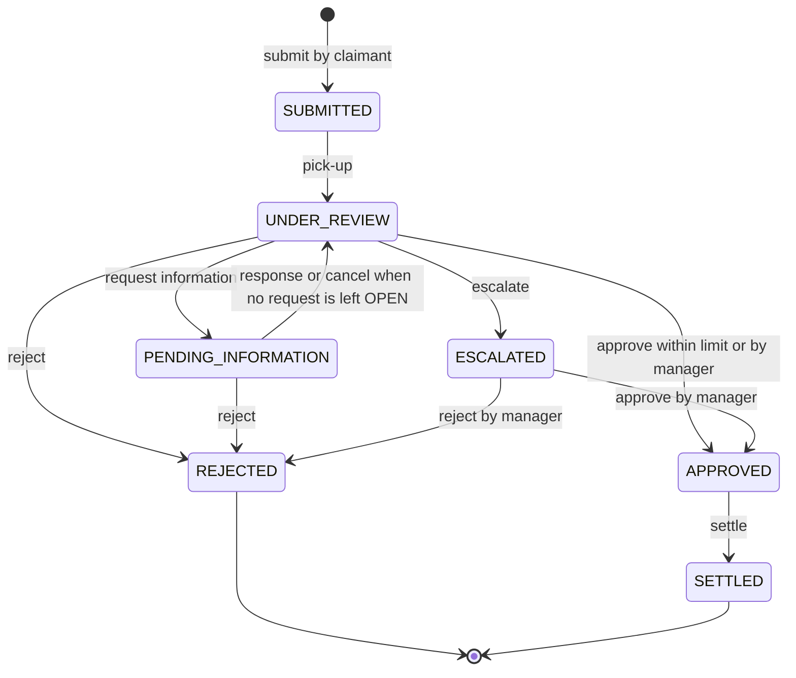

# 04. API Design

Status: **Planned** (no endpoint exists yet). The committed contract `src/main/resources/openapi/claims-api.yaml` is exported from the running application in the last prompt; until then this document is the design.
Date: 2026-10-25. Source of truth: [PROJECT_SPEC.md](PROJECT_SPEC.md) sections 5, 6, 7.

## 1. Conventions

| Topic | Convention |
|---|---|
| Base path and versioning | `/api/v1`. The version is in the path; a breaking change would introduce `/api/v2` next to it |
| Format | JSON in and out; errors are `application/problem+json` |
| Naming | Plural nouns, kebab-case paths, commands as sub-resources: `/claims/{claimNumber}/approve` |
| Identifiers | Claims are addressed by claim number (`CLM-10001`, `CLP-10001`), users by user id, policies by policy number. Internal database ids are not exposed |
| Create | `201 Created` with a `Location` header |
| Pagination | Query `page` (starts at 0) and `size` (default 10, capped at 50). Responses use `PageResponse`: `content`, `page`, `size`, `totalElements`, `totalPages`, `last` |
| Sorting | `sort=field,dir` (`dir` is `asc` or `desc`), limited to a whitelist per endpoint; an unlisted field is a 400 |
| Filtering | Query parameters, implemented with `Specification` objects or separate repository methods. No `(:x is null or ...)` JPQL |
| Idempotency | `POST /claims` accepts an optional `Idempotency-Key` header of 8 to 64 characters |
| Correlation id | `X-Correlation-Id` on every request and response; generated when absent, put in the logging MDC, repeated in error bodies |
| Money | Decimal numbers with the currency's scale (JPY 0 decimals, the others 2), together with a `currencyCode` field |
| Times | ISO 8601 in UTC (`Instant`); dates are `YYYY-MM-DD` |
| Authentication | `Authorization: Bearer <token>` except on public paths |

### Status code policy

| Situation | Status |
|---|---|
| No token, invalid or expired token, unknown or inactive user | 401 |
| Role not allowed for the endpoint | 403 |
| Unknown resource, or resource outside the caller's scope | 404 (never 403, so existence is not revealed) |
| Invalid request (bean validation, malformed JSON, bad enum, bad parameter) | 400 |
| Business-rule violation | 422 |
| Invalid state transition, duplicate, concurrent modification | 409 |
| Upstream failure (payment gateway) | 502 |
| Unexpected failure | 500 with a generic message; the stack trace goes to the log only |

## 2. Error contract

Errors follow RFC 7807 `ProblemDetail` (`application/problem+json`) with extra properties: `code` (machine-readable), `timestamp`, `correlationId`, and for validation failures `errors: [{ "field", "message" }]`.

| Code | Status | Raised when |
|---|---|---|
| `VALIDATION_FAILED` | 400 | Bean validation fails, a required parameter is missing or has the wrong type |
| `MALFORMED_REQUEST` | 400 | Unreadable JSON or an invalid enum value |
| `UNAUTHENTICATED` | 401 | Missing or invalid token, failed login |
| `ACCESS_DENIED` | 403 | The role is not allowed (handled explicitly so that it is not turned into a 500) |
| `RESOURCE_NOT_FOUND` | 404 | Unknown or out-of-scope resource |
| `DUPLICATE_RESOURCE` | 409 | A unique value already exists (user id, email); also used for data-integrity conflicts |
| `CLAIM_INVALID_TRANSITION` | 409 | The action is not allowed in the claim's current status |
| `CLAIM_ALREADY_ASSIGNED` | 409 | Pick-up lost the race or the claim is already assigned |
| `CONCURRENT_MODIFICATION` | 409 | Optimistic lock failure |
| `DUPLICATE_CLAIM` | 409 | Same policy, incident date and claim type as a claim that is not rejected |
| `POLICY_NOT_FOUND` | 422 | The policy does not exist or does not belong to the claimant |
| `POLICY_NOT_ACTIVE` | 422 | The policy is not ACTIVE or does not cover the incident date |
| `POLICY_TYPE_MISMATCH` | 422 | Claim type differs from the policy product type |
| `POLICY_MARKET_MISMATCH` | 422 | The policy is in another market than the claimant |
| `AMOUNT_EXCEEDS_SUM_INSURED` | 422 | Claimed amount is above the sum insured |
| `ASSESSMENT_REQUIRED` | 409 | Approval without a latest assessment that confirms coverage with a payout above zero |
| `APPROVAL_LIMIT_EXCEEDED` | 422 | An officer approves above the market's escalation threshold ("escalate to a manager") |
| `INFORMATION_REQUEST_NOT_OPEN` | 409 | Responding to or cancelling a request that is not OPEN |
| `PAYMENT_GATEWAY_UNAVAILABLE` | 502 | The payment gateway failed; the claim stays APPROVED |
| `INTERNAL_ERROR` | 500 | Anything unhandled |

Example (validation failure):

```json
{
  "type": "about:blank",
  "title": "Bad Request",
  "status": 400,
  "detail": "Request validation failed",
  "instance": "/api/v1/claims",
  "code": "VALIDATION_FAILED",
  "timestamp": "2026-10-25T04:55:12.481Z",
  "correlationId": "5b0e5d6f-2f0c-4d0b-9d1c-7f7a1a0c9e11",
  "errors": [
    { "field": "claimedAmount", "message": "must be greater than 0" },
    { "field": "description", "message": "size must be between 10 and 1000" }
  ]
}
```

## 3. Resource model

| Resource | Path | Notes |
|---|---|---|
| Session | `/auth/login`, `/auth/register` | Public |
| User | `/users`, `/users/me` | Managers create and list; everyone reads their own profile |
| Market | `/markets`, `/markets/{code}` | Read-only reference data |
| Policy | `/policies/mine`, `/policies/{policyNumber}` | Claimants read their own; managers maintain |
| Claim | `/claims`, `/claims/{claimNumber}` | Aggregate root |
| Claim timeline | `/claims/{claimNumber}/timeline` | Claimants see PUBLIC entries only |
| Assessment | `/claims/{claimNumber}/assessments` | Staff only; internal |
| Information request | `/claims/{claimNumber}/information-requests[/{requestId}]` | |
| Claim commands | `/claims/{claimNumber}/{pick-up, assign, escalate, approve, reject, settle}` | `POST`, each causes one transition |
| Claim queue | `/claims/queue` | Literal path; must win over `/claims/{claimNumber}` |
| Notification | `/notifications`, `/notifications/unread-count`, `/notifications/{id}/read`, `/notifications/read-all` | Own notifications only |
| Report | `/reports/{overview, exposure, aging, workload, performance}` | Read side, computed live |
| Health | `/actuator/health` | Public |

## 4. Endpoint catalogue

All paths are under `/api/v1` except `/actuator/health`. "Any" means any logged-in role. Every protected endpoint can also return 401. The "Statuses" column lists the success status first and then the errors specific to the endpoint, in addition to 401 and 403 for the roles that are not allowed.

| Method and path | Who | Statuses |
|---|---|---|
| `POST /auth/login?role=` | public | 200; 400 (missing role or body), 401 (same message for every failure) |
| `POST /auth/register` | public | 201 (no token); 400; 404 unknown `marketCode`; 409 `DUPLICATE_RESOURCE` |
| `GET /users/me` | any | 200 |
| `POST /users` | MANAGER | 201; 400 (OFFICER without market, MANAGER with market); 404 unknown market; 409 |
| `GET /users?role=&marketCode=&page=&size=` | MANAGER | 200; 400 |
| `GET /markets`, `GET /markets/{code}` | any | 200; 404 |
| `GET /policies/mine` | CLAIMANT | 200 |
| `GET /policies/{policyNumber}` | OFFICER (own market), MANAGER | 200; 404 (unknown or other market) |
| `PUT /policies/{policyNumber}` | MANAGER | 201 on create, 200 on update; 400; 404 unknown market or holder |
| `POST /claims` | CLAIMANT | 201 (`Location`); 200 with `Idempotent-Replay: true` on a repeated key; 400; 409 `DUPLICATE_CLAIM`; 422 policy errors and `AMOUNT_EXCEEDS_SUM_INSURED` |
| `GET /claims?status=&claimType=&marketCode=&assignedTo=&unassigned=&submittedFrom=&submittedTo=&page=&size=&sort=` | any | 200, scoped by role; 400 (bad filter, sort or page). `assignedTo` is `me` or a user id |
| `GET /claims/queue` | OFFICER, MANAGER | 200: SUBMITTED unassigned claims, oldest first, each with `ageHours` and `slaBreached` |
| `GET /claims/{claimNumber}` | any | 200; 404 |
| `GET /claims/{claimNumber}/timeline` | any | 200; 404 |
| `POST /claims/{claimNumber}/pick-up` | OFFICER, MANAGER | 200; 404; 409 `CLAIM_ALREADY_ASSIGNED` or `CLAIM_INVALID_TRANSITION` |
| `POST /claims/{claimNumber}/assign` | MANAGER | 200; 400; 404 (claim, or officer unknown, inactive or of another market); 409 `CLAIM_INVALID_TRANSITION` |
| `POST /claims/{claimNumber}/assessments` | OFFICER, MANAGER | 201; 400; 403 (officer who is not the assignee); 404; 409 `CLAIM_INVALID_TRANSITION` |
| `GET /claims/{claimNumber}/assessments` | OFFICER, MANAGER | 200; 404 |
| `POST /claims/{claimNumber}/information-requests` | OFFICER, MANAGER | 201; 400; 404; 409 `CLAIM_INVALID_TRANSITION` |
| `GET /claims/{claimNumber}/information-requests` | any | 200; 404 |
| `POST /claims/{claimNumber}/information-requests/{requestId}/respond` | CLAIMANT | 200; 400; 404; 409 `INFORMATION_REQUEST_NOT_OPEN` |
| `POST /claims/{claimNumber}/information-requests/{requestId}/cancel` | OFFICER, MANAGER | 200; 404; 409 `INFORMATION_REQUEST_NOT_OPEN` |
| `POST /claims/{claimNumber}/escalate` | OFFICER | 200; 400 (`remarks` required); 404; 409 `CLAIM_INVALID_TRANSITION` |
| `POST /claims/{claimNumber}/approve` | OFFICER, MANAGER | 200; 400; 404; 409 `ASSESSMENT_REQUIRED`, `CLAIM_INVALID_TRANSITION`, `CONCURRENT_MODIFICATION`; 422 `APPROVAL_LIMIT_EXCEEDED` |
| `POST /claims/{claimNumber}/reject` | OFFICER, MANAGER | 200; 400 (`reasonCode`, `remarks`); 404; 409 `CLAIM_INVALID_TRANSITION` |
| `POST /claims/{claimNumber}/settle` | OFFICER, MANAGER | 200; 400; 404; 409 `CLAIM_INVALID_TRANSITION`; 502 `PAYMENT_GATEWAY_UNAVAILABLE` |
| `GET /notifications?unreadOnly=&page=&size=` | any | 200 |
| `GET /notifications/unread-count` | any | 200 |
| `POST /notifications/{id}/read` | any | 200; 404 (not the caller's notification) |
| `POST /notifications/read-all` | any | 200 |
| `GET /reports/overview` | OFFICER (own market), MANAGER | 200 |
| `GET /reports/exposure` | MANAGER | 200 |
| `GET /reports/aging` | OFFICER (own market), MANAGER | 200 |
| `GET /reports/workload` | OFFICER (own team), MANAGER | 200 |
| `GET /reports/performance?from=&to=&marketCode=` | OFFICER (own team), MANAGER | 200; 400 (`from` after `to`) |
| `GET /actuator/health` | public | 200 |

Also public: `GET /` (redirects to Swagger UI, hidden from OpenAPI), `/swagger-ui.html`, `/swagger-ui/**`, `/v3/api-docs/**`.

Routing note: `GET /claims/queue` is a literal path and must win over `GET /claims/{claimNumber}`. A test covers this.

Per-endpoint behaviour (who can act on which status, approval limits, scope rules) is defined in the specification, section 5; it is not repeated here.

### Details to confirm during implementation

The specification does not fix these points; the choices above are the design's working assumptions and the claims-core prompt confirms or changes them.

1. An officer who can see a claim but is not its assignee, and tries to assess, request information, reject or settle it, receives 403 `ACCESS_DENIED`.
2. `POST /claims/{n}/assign` with an unknown, inactive or other-market officer returns 404 `RESOURCE_NOT_FOUND`.
3. An `approvedAmount` above the recommended payout is a business-rule violation (422); the error-code list has no dedicated code for it.
4. Behaviour of `assign` on a claim that is still SUBMITTED (see open question 5 in [01-problem-analysis.md](01-problem-analysis.md)).
5. An OFFICER passing a `marketCode` other than their own to a report is treated as out of scope (404).
6. Allowed `sort` fields for `GET /claims`: `claimNumber`, `status`, `claimedAmount`, `incidentDate`, `createdAt` (default `createdAt,desc`).
7. A repeated `Idempotency-Key` returns the original claim without comparing the request body.

## 5. Claim state diagram



- Open statuses: SUBMITTED, UNDER_REVIEW, PENDING_INFORMATION, ESCALATED. REJECTED and SETTLED are final.
- A manager can reassign a claim in UNDER_REVIEW, PENDING_INFORMATION and ESCALATED to an active officer of the claim's market. Reassignment does not change the status, so it is not a transition in the diagram.
- The transition rules live in one pure class, `ClaimWorkflow`, covered by unit tests for every allowed and forbidden transition.

## 6. Examples of the main flows

Claim numbers below are illustrative. The real numbers on a fresh database are confirmed during verification in the last prompt.

### 6.1 Login

`POST /api/v1/auth/login?role=CLAIMANT`

```json
{ "userId": "claimant.in", "password": "Claimant@123" }
```

`200 OK`

```json
{
  "accessToken": "<jwt>",
  "tokenType": "Bearer",
  "expiresInSeconds": 7200,
  "user": { "userId": "claimant.in", "fullName": "Claimant India", "role": "CLAIMANT", "marketCode": "IN" }
}
```

A wrong user, password, inactive account or wrong role all return `401` with the message "Invalid user ID, password or role".

### 6.2 Submit a motor claim

`POST /api/v1/claims` with header `Idempotency-Key: 7d9f3c52-claim-0001`

```json
{
  "claimType": "MOTOR",
  "policyNumber": "MOT-IN-0001",
  "claimedAmount": 45000.00,
  "incidentDate": "2026-10-12",
  "incidentLocation": "MG Road, Bengaluru",
  "description": "Rear-ended at a traffic signal; bumper and boot lid damaged.",
  "motor": {
    "vehicleRegistrationNumber": "KA01AB1234",
    "vehicleMake": "Hyundai",
    "vehicleModel": "i20",
    "vehicleYear": 2021,
    "damageType": "COLLISION",
    "policeReportNumber": "FIR-2026-5521"
  }
}
```

`201 Created`, `Location: /api/v1/claims/CLM-10003`

```json
{
  "claimNumber": "CLM-10003",
  "claimType": "MOTOR",
  "status": "SUBMITTED",
  "policyNumber": "MOT-IN-0001",
  "marketCode": "IN",
  "currencyCode": "INR",
  "claimedAmount": 45000.00,
  "incidentDate": "2026-10-12",
  "assignedOfficerUserId": null,
  "createdAt": "2026-10-25T05:01:44Z"
}
```

Sending the same request again with the same key returns `200 OK` with the same body and header `Idempotent-Replay: true`. A property claim sends a `property` block (`propertyAddress`, `propertyType`, `perilType`) instead of `motor`; sending the wrong block or none is a `400`.

### 6.3 Officer works the claim

1. `GET /api/v1/claims/queue` (as `officer.in`): the claim appears with `ageHours` and `slaBreached`.
2. `POST /api/v1/claims/CLM-10003/pick-up`: status becomes `UNDER_REVIEW`, `assignedOfficerUserId` is `officer.in`. A second officer racing for the same claim receives `409 CLAIM_ALREADY_ASSIGNED`.
3. `POST /api/v1/claims/CLM-10003/assessments`:

```json
{
  "assessedLossAmount": 44000.00,
  "coverageConfirmed": true,
  "recommendation": "APPROVE",
  "notes": "Photos match the repair estimate."
}
```

The response includes the computed `deductibleApplied` (the claim's deductible snapshot) and `recommendedPayout` = `max(0, min(assessedLossAmount, policySumInsured) - deductible)` when coverage is confirmed, otherwise 0.

4. `POST /api/v1/claims/CLM-10003/information-requests` with `{ "question": "Please state the repair workshop's name.", "dueInDays": 7 }`: status becomes `PENDING_INFORMATION`. The claimant answers with `POST .../information-requests/{requestId}/respond` and `{ "responseText": "Sunrise Auto Works, Bengaluru." }`; the claim returns to `UNDER_REVIEW`.

### 6.4 Decision and settlement

`POST /api/v1/claims/CLM-10003/approve` with `{ "approvedAmount": 43500.00, "remarks": "Approved as assessed." }` returns `200` and status `APPROVED`. An officer asking for more than the market's escalation threshold receives:

```json
{
  "status": 422,
  "code": "APPROVAL_LIMIT_EXCEEDED",
  "detail": "Approved amount exceeds the escalation threshold for market IN; escalate to a manager.",
  "correlationId": "5b0e5d6f-2f0c-4d0b-9d1c-7f7a1a0c9e11"
}
```

`POST /api/v1/claims/CLM-10003/settle` with `{ "paymentMethod": "BANK_TRANSFER" }` returns `200`, status `SETTLED`, a `paymentReference` of the form `PAY-` plus 12 upper-case hexadecimal characters, `settledAmount` and `settledAt`. If the gateway fails the response is `502 PAYMENT_GATEWAY_UNAVAILABLE`, the claim stays `APPROVED`, and no timeline entry or event is written.

### 6.5 Reject and escalate

- `POST /api/v1/claims/CLM-10004/reject` with `{ "reasonCode": "INSUFFICIENT_EVIDENCE", "remarks": "No police report or photographs were supplied." }`. Reason codes: `POLICY_INACTIVE`, `NOT_COVERED`, `FRAUD_SUSPECTED`, `INSUFFICIENT_EVIDENCE`, `DUPLICATE_CLAIM`, `INFORMATION_NOT_PROVIDED`, `OTHER`.
- `POST /api/v1/claims/CLM-10004/escalate` with `{ "remarks": "Amount is above my approval limit." }` moves the claim to `ESCALATED`; only a manager can then approve or reject it.
