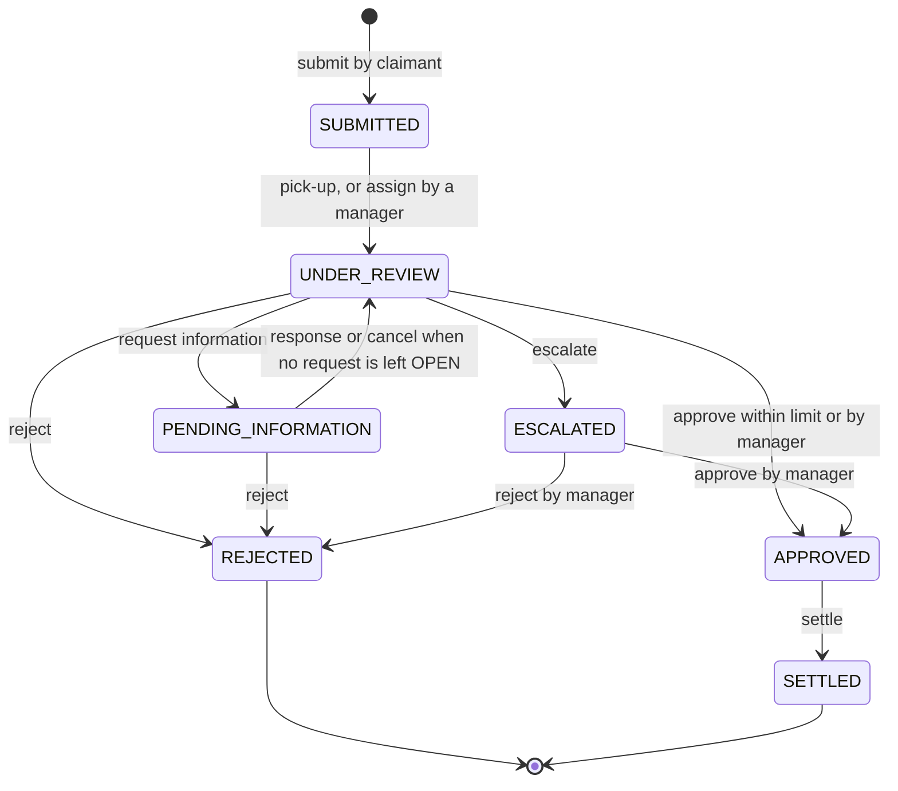

# 04. API Design

Status: **partly Implemented.** The error contract, correlation ids, the authentication, user and market endpoints and the health endpoint were built and verified in prompt 3. The policy endpoints and every claim endpoint except settlement (submission, list, queue, detail, timeline, pick-up, assignment, assessments, information requests, escalation, approval, rejection) were built and verified in prompt 4. The catalogue in section 4 has a Status column. Settlement, notifications and reports are still **Planned**. The committed contract `src/main/resources/openapi/claims-api.yaml` is exported from the running application in the last prompt; until then this document is the design.
Date: 2026-10-25. Source of truth: [PROJECT_SPEC.md](PROJECT_SPEC.md) sections 5, 6, 7.

## 1. Conventions

| Topic | Convention |
|---|---|
| Base path and versioning | `/api/v1`. The version is in the path; a breaking change would introduce `/api/v2` next to it |
| Format | JSON in and out; errors are `application/problem+json` |
| Naming | Plural nouns, kebab-case paths, commands as sub-resources: `/claims/{claimNumber}/approve` |
| Identifiers | Claims are addressed by claim number (`CLM-10001`, `CLP-10001`), users by user id, policies by policy number. Internal database ids are not exposed |
| Create | `201 Created` with a `Location` header where the new resource has a URL of its own. Registration and `POST /users` return the account in the body without a `Location`, because there is no `GET /users/{userId}` to point at |
| Pagination | Query `page` (starts at 0) and `size` (default 10, capped at 50). A `size` above 50 is **capped, not rejected**; a `size` below 1 or a negative `page` is a 400 naming the parameter. Responses use `PageResponse`: `content`, `page`, `size`, `totalElements`, `totalPages`, `last` |
| Sorting | `sort=field,dir` (`dir` is `asc` or `desc`, not case sensitive), limited to a whitelist per endpoint; an unlisted field, an unknown direction or more than two parts is a 400 naming `sort`. The whitelist of `GET /users` is `userId` and `createdAt` (default `userId,asc`); the whitelist of `GET /claims` is `createdAt`, `claimedAmount`, `incidentDate` and `claimNumber` (default `createdAt,desc`); the id is added as a tie-breaker so pages are stable. `GET /claims/queue` takes no `sort`: it is always oldest first |
| Filtering | Query parameters, implemented with `Specification` objects or separate repository methods. No `(:x is null or ...)` JPQL |
| Idempotency | `POST /claims` accepts an optional `Idempotency-Key` header of 8 to 64 characters |
| Correlation id | `X-Correlation-Id` on every response, including a 401 written by the security filters. A client value is echoed only if it matches `^[A-Za-z0-9._-]{1,64}$`; otherwise (missing, too long, spaces, line breaks, markup) a new UUID is generated and the client value is never reflected. The id is put in the logging context (`%X{correlationId}` in the log pattern), repeated as `correlationId` in every error body, and removed from the context when the request ends |
| Money | Decimal numbers with the currency's scale (JPY 0 decimals, the others 2), together with a `currencyCode` field |
| Times | ISO 8601 in UTC (`Instant`); dates are `YYYY-MM-DD` |
| Authentication | `Authorization: Bearer <token>` except on public paths. A 401 carries `WWW-Authenticate: Bearer` |

### Status code policy

| Situation | Status |
|---|---|
| No token, invalid, tampered, expired or foreign-issuer token; the token's user was deleted or deactivated (checked on every request) | 401 |
| Role not allowed for the endpoint | 403 |
| Unknown resource, or resource outside the caller's scope | 404 (never 403, so existence is not revealed) |
| Invalid request (bean validation, malformed JSON, bad enum, bad parameter) | 400 |
| Business-rule violation | 422 |
| Invalid state transition, duplicate, concurrent modification | 409 |
| Upstream failure (payment gateway) | 502 |
| Unsupported method, unsupported media type | 405, 415 (both with code `MALFORMED_REQUEST`) |
| Unknown path, for an authenticated caller | 404 `RESOURCE_NOT_FOUND` (an anonymous caller gets 401 first) |
| Unexpected failure | 500 with the generic message "Unexpected error"; the stack trace goes to the log only |

## 2. Error contract

Errors follow RFC 7807 `ProblemDetail` (`application/problem+json`) with extra properties: `code` (machine-readable), `timestamp` (ISO instant, UTC), `correlationId`, and for validation failures `errors: [{ "field", "message" }]`. Every error body has `type` (`about:blank`), `title` (the HTTP reason phrase), `status`, `detail` and `instance` (the request path). The error codes are the 20 in the table below and are fixed by a test.

| Code | Status | Raised when |
|---|---|---|
| `VALIDATION_FAILED` | 400, 422 | Bean validation fails (including method-level validation of parameters); a required parameter is missing or has the wrong type, for example an unknown `role`; a `page`, `size` or `sort` value is invalid; an account rule is broken (market missing or unknown, role not allowed); a claim request breaks a rule that needs the data (block, date range, scale, idempotency key length). **Status 422 with this code** is used for two business rules on a named field, because the list of codes has no dedicated code for them: `officerUserId` of `assign` is not an active officer of the claim's market (or already has the claim), and `approvedAmount` is above the recommended payout. The `detail` names the field |
| `MALFORMED_REQUEST` | 400, 405, 415 | Unreadable JSON, a wrong type or an invalid enum value in the body (the `detail` names the field and never echoes the value); unsupported method; unsupported media type |
| `UNAUTHENTICATED` | 401 | Missing, malformed, tampered, expired or foreign-issuer token; the user of the token no longer exists or is inactive; failed login |
| `ACCESS_DENIED` | 403 | The role is not allowed (handled explicitly so that it is not turned into a 500) |
| `RESOURCE_NOT_FOUND` | 404 | Unknown or out-of-scope resource |
| `DUPLICATE_RESOURCE` | 409 | A unique value already exists (user id, email); also used for data-integrity conflicts |
| `CLAIM_INVALID_TRANSITION` | 409 | The action is not allowed in the claim's current status |
| `CLAIM_ALREADY_ASSIGNED` | 409 | Pick-up of a claim that is already with an officer, including the loser of two simultaneous pick-ups (and an `assign` from the queue that lost the same race) |
| `CONCURRENT_MODIFICATION` | 409 | Optimistic lock failure |
| `DUPLICATE_CLAIM` | 409 | Same policy, incident date and claim type as a claim that is not rejected |
| `POLICY_NOT_FOUND` | 422 | The policy does not exist or does not belong to the claimant |
| `POLICY_NOT_ACTIVE` | 422 | The policy is not ACTIVE or does not cover the incident date |
| `POLICY_TYPE_MISMATCH` | 422 | Claim type differs from the policy product type |
| `POLICY_MARKET_MISMATCH` | 422 | The policy is in another market than the claimant |
| `AMOUNT_EXCEEDS_SUM_INSURED` | 422 | Claimed amount is above the sum insured |
| `ASSESSMENT_REQUIRED` | 409 | Approval without a latest assessment that confirms coverage with a payout above zero |
| `APPROVAL_LIMIT_EXCEEDED` | 422 | An officer approves above the market's escalation threshold ("escalate to a manager") |
| `INFORMATION_REQUEST_NOT_OPEN` | 409 | Responding to or cancelling a request that is not OPEN |
| `PAYMENT_GATEWAY_UNAVAILABLE` | 502 | The payment gateway failed; the claim stays APPROVED |
| `INTERNAL_ERROR` | 500 | Anything unhandled; the message is always "Unexpected error" |

### How exceptions become responses (implemented)

One `GlobalExceptionHandler` in `shared.api` produces every error body; the security filters use the same `ProblemDetails` factory.

| Exception | Status and code | Notes |
|---|---|---|
| Any `ApiException` (the base of every business exception) | its own status and code | A `ValidationFailedException` also carries `errors`. Failures with status 5xx are logged at WARN without a stack trace |
| `MethodArgumentNotValidException`, `HandlerMethodValidationException`, `ConstraintViolationException` | 400 `VALIDATION_FAILED` | `errors` lists every field, sorted by field then message; rejected values are never echoed, so a rejected password is not repeated |
| `MissingServletRequestParameterException`, `MethodArgumentTypeMismatchException` | 400 `VALIDATION_FAILED` | The parameter is named; for an enum the allowed values are listed ("must be one of CLAIMANT, OFFICER, MANAGER") |
| `HttpMessageNotReadableException` | 400 `MALFORMED_REQUEST` | "Malformed request body" or "Invalid value for field 'kind'" |
| Spring's own 405 and 415 | 405, 415 `MALFORMED_REQUEST` | The `Allow` header is kept |
| `NoResourceFoundException` | 404 `RESOURCE_NOT_FOUND` | |
| `AccessDeniedException` | 403 `ACCESS_DENIED` | Handled explicitly; a failed `@PreAuthorize` is never a 500. The exception's own message is not shown |
| `AuthenticationException` | 401 `UNAUTHENTICATED` | "Authentication required" |
| `ObjectOptimisticLockingFailureException` | 409 `CONCURRENT_MODIFICATION` | |
| `DataIntegrityViolationException` | 409 `DUPLICATE_RESOURCE` | Generic message; no SQL or constraint name |
| Anything else | 500 `INTERNAL_ERROR` | Logged with its stack trace and the correlation id |

Two properties of the implementation worth knowing:

- **Validation can come before authorization.** Spring MVC binds and validates `@Valid @RequestBody` before the method-security check of `@PreAuthorize` runs. A caller without the role who sends an invalid body therefore gets the 400 validation error, not a 403; with a valid body the same caller gets 403. Only field names and messages are shown, and the OpenAPI document lists them publicly anyway. A test records this behaviour.
- **Token role changes are not live.** The role in the token is trusted until the token expires (120 minutes). A deleted or deactivated user is rejected at once, but a role change for an active user only applies after the next login.

Example (validation failure):

```json
{
  "type": "about:blank",
  "title": "Bad Request",
  "status": 400,
  "detail": "Request validation failed",
  "instance": "/api/v1/claims",
  "code": "VALIDATION_FAILED",
  "timestamp": "2026-10-25T04:55:12.481Z",
  "correlationId": "5b0e5d6f-2f0c-4d0b-9d1c-7f7a1a0c9e11",
  "errors": [
    { "field": "claimedAmount", "message": "must be greater than 0" },
    { "field": "description", "message": "size must be between 10 and 1000" }
  ]
}
```

## 3. Resource model

| Resource | Path | Notes |
|---|---|---|
| Session | `/auth/login`, `/auth/register` | Public |
| User | `/users`, `/users/me` | Managers create and list; everyone reads their own profile |
| Market | `/markets`, `/markets/{code}` | Read-only reference data |
| Policy | `/policies/mine`, `/policies/{policyNumber}` | Claimants read their own; managers maintain |
| Claim | `/claims`, `/claims/{claimNumber}` | Aggregate root |
| Claim timeline | `/claims/{claimNumber}/timeline` | Claimants see PUBLIC entries only |
| Assessment | `/claims/{claimNumber}/assessments` | Staff only; internal |
| Information request | `/claims/{claimNumber}/information-requests[/{requestId}]` | |
| Claim commands | `/claims/{claimNumber}/{pick-up, assign, escalate, approve, reject, settle}` | `POST`, each causes one transition |
| Claim queue | `/claims/queue` | Literal path; must win over `/claims/{claimNumber}` |
| Notification | `/notifications`, `/notifications/unread-count`, `/notifications/{id}/read`, `/notifications/read-all` | Own notifications only |
| Report | `/reports/{overview, exposure, aging, workload, performance}` | Read side, computed live |
| Health | `/actuator/health` | Public |

## 4. Endpoint catalogue

All paths are under `/api/v1` except `/actuator/health`. "Any" means any logged-in role. Every protected endpoint can also return 401. The "Statuses" column lists the success status first and then the errors specific to the endpoint, in addition to 401 and 403 for the roles that are not allowed.

| Method and path | Who | Statuses | Status |
|---|---|---|---|
| `POST /auth/login?role=` | public | 200; 400 (missing or unknown `role`, blank `userId` or `password`, missing or malformed body); 401 (the same message and code for every kind of failure) | Implemented |
| `POST /auth/register` | public | 201 (no token, no `Location`); 400 (validation, unknown or inactive market: the field is `marketCode`); 409 `DUPLICATE_RESOURCE` (user id or email, not case sensitive) | Implemented |
| `GET /users/me` | any | 200; 401 (also when the account was deleted or deactivated after the token was issued) | Implemented |
| `POST /users` | MANAGER | 201 (no `Location`); 400 (role CLAIMANT, OFFICER without market, MANAGER with market, unknown market, validation); 403; 409 `DUPLICATE_RESOURCE` | Implemented |
| `GET /users?role=&marketCode=&page=&size=&sort=` | MANAGER | 200; 400 (unknown `role`, invalid `page`, `size` or `sort`); 403 | Implemented |
| `GET /markets`, `GET /markets/{code}` | any | 200; 404 `RESOURCE_NOT_FOUND` (the code is not case sensitive) | Implemented |
| `GET /policies/mine` | CLAIMANT | 200 (own policies, ordered by number); 403 | Implemented |
| `GET /policies/{policyNumber}` | OFFICER (own market), MANAGER | 200; 403 (claimant); 404 (unknown, or a policy of another market for an officer); the number is not case sensitive | Implemented |
| `PUT /policies/{policyNumber}` | MANAGER | 201 with `Location` on create, 200 on update; 400 (validation, unknown market, holder unknown, inactive, not a claimant or of another market, `validTo` not after `validFrom`, deductible above the sum insured, wrong scale, a change of type, market or holder of an existing policy); 403 | Implemented |
| `POST /claims` | CLAIMANT | 201 (`Location`); 200 with `Idempotent-Replay: true` on a repeated key; 400 (validation, motor or property block rules, incident date, scale, vehicle year, `Idempotency-Key` not 8 to 64 characters); 403; 409 `DUPLICATE_CLAIM`; 422 `POLICY_NOT_FOUND`, `POLICY_NOT_ACTIVE`, `POLICY_TYPE_MISMATCH`, `POLICY_MARKET_MISMATCH`, `AMOUNT_EXCEEDS_SUM_INSURED` | Implemented |
| `GET /claims?status=&claimType=&marketCode=&assignedTo=&unassigned=&submittedFrom=&submittedTo=&page=&size=&sort=` | any | 200, scoped by role; 400 (bad status, type or date, `submittedFrom` after `submittedTo`, bad page, size or sort). `assignedTo` is `me` or a user id; both dates are inclusive | Implemented |
| `GET /claims/queue` | OFFICER, MANAGER | 200: SUBMITTED unassigned claims, oldest first, each with `ageHours` and `slaBreached`; 403 (claimant) | Implemented |
| `GET /claims/{claimNumber}` | any | 200; 404 (unknown, or outside the caller's scope) | Implemented |
| `GET /claims/{claimNumber}/timeline` | any | 200 (a claimant receives the PUBLIC entries only); 404 | Implemented |
| `POST /claims/{claimNumber}/pick-up` | OFFICER, MANAGER | 200; 403 (claimant); 404; 409 `CLAIM_ALREADY_ASSIGNED` (someone else took the claim, including the loser of a race) or `CLAIM_INVALID_TRANSITION` (an approved or rejected claim) | Implemented |
| `POST /claims/{claimNumber}/assign` | MANAGER | 200; 400 (`officerUserId` blank); 403; 404 (claim); 409 `CLAIM_INVALID_TRANSITION`; 422 (the target is not an active officer of the claim's market, or already has the claim) | Implemented |
| `POST /claims/{claimNumber}/assessments` | OFFICER, MANAGER | 201 (`Location` is the list); 400; 403 (claimant, or an officer who is not the assignee); 404; 409 `CLAIM_INVALID_TRANSITION` | Implemented |
| `GET /claims/{claimNumber}/assessments` | OFFICER, MANAGER | 200, newest first; 403 (claimant); 404 | Implemented |
| `POST /claims/{claimNumber}/information-requests` | OFFICER, MANAGER | 201 (the request, `Location` is the list); 400; 403 (claimant, or an officer who is not the assignee); 404; 409 `CLAIM_INVALID_TRANSITION` | Implemented |
| `GET /claims/{claimNumber}/information-requests` | any | 200, oldest first, `overdue` computed when read; 404 | Implemented |
| `POST /claims/{claimNumber}/information-requests/{requestId}/respond` | CLAIMANT | 200 (the claim); 400; 403 (staff); 404 (not the claimant's claim, or a request of another claim); 409 `INFORMATION_REQUEST_NOT_OPEN` | Implemented |
| `POST /claims/{claimNumber}/information-requests/{requestId}/cancel` | OFFICER, MANAGER | 200 (the claim); 403 (claimant, or an officer who is not the assignee); 404; 409 `INFORMATION_REQUEST_NOT_OPEN` | Implemented |
| `POST /claims/{claimNumber}/escalate` | OFFICER | 200; 400 (`remarks` 10 to 1000 characters); 403 (manager, claimant, or an officer who is not the assignee); 404; 409 `CLAIM_INVALID_TRANSITION` | Implemented |
| `POST /claims/{claimNumber}/approve` | OFFICER, MANAGER | 200 (the body may be left out); 400 (amount not above 0, or too many decimal places); 403 (not the assignee, or an officer on an ESCALATED claim); 404; 409 `ASSESSMENT_REQUIRED`, `CLAIM_INVALID_TRANSITION`, `CONCURRENT_MODIFICATION`; 422 `APPROVAL_LIMIT_EXCEEDED`, or `approvedAmount` above the recommended payout | Implemented |
| `POST /claims/{claimNumber}/reject` | OFFICER, MANAGER | 200; 400 (`reasonCode`, `remarks`); 403 (not the assignee, or an officer on an ESCALATED claim); 404; 409 `CLAIM_INVALID_TRANSITION` | Implemented |
| `POST /claims/{claimNumber}/settle` | OFFICER, MANAGER | 200; 400; 404; 409 `CLAIM_INVALID_TRANSITION`; 502 `PAYMENT_GATEWAY_UNAVAILABLE` | Planned |
| `GET /notifications?unreadOnly=&page=&size=` | any | 200 | Planned |
| `GET /notifications/unread-count` | any | 200 | Planned |
| `POST /notifications/{id}/read` | any | 200; 404 (not the caller's notification) | Planned |
| `POST /notifications/read-all` | any | 200 | Planned |
| `GET /reports/overview` | OFFICER (own market), MANAGER | 200 | Planned |
| `GET /reports/exposure` | MANAGER | 200 | Planned |
| `GET /reports/aging` | OFFICER (own market), MANAGER | 200 | Planned |
| `GET /reports/workload` | OFFICER (own team), MANAGER | 200 | Planned |
| `GET /reports/performance?from=&to=&marketCode=` | OFFICER (own team), MANAGER | 200; 400 (`from` after `to`) | Planned |
| `GET /actuator/health` | public | 200 | Implemented |

Also public: `GET /` (redirects to Swagger UI, hidden from OpenAPI), `/swagger-ui.html`, `/swagger-ui/**`, `/v3/api-docs/**`.

Routing note: `GET /claims/queue` is a literal path and must win over `GET /claims/{claimNumber}`. A test covers this.

Per-endpoint behaviour (who can act on which status, approval limits, scope rules) is defined in the specification, section 5; it is not repeated here.

### Details to confirm during implementation

The specification does not fix these points; the choices were working assumptions of the design and the claims-core prompt confirmed or changed them.

Settled in prompt 4 (no longer open):

1. An officer who can see a claim but is not its assignee, and tries to assess, request information, cancel a request, escalate, approve or reject it, receives **403** `ACCESS_DENIED`. A claim that is out of scope is a **404**. A manager is never refused for not being the assignee. On an ESCALATED claim an officer is refused with a message that says the claim is escalated.
2. `POST /claims/{n}/assign` with an unknown, inactive, non-officer or other-market target is a **422**, not a 404 as first assumed. The message is the same for every case (`officerUserId must be an active officer of market IN.`), so it does not reveal whether a user id exists. The status code is 422 and the code is `VALIDATION_FAILED`.
3. An `approvedAmount` above the recommended payout is a **422** with the code `VALIDATION_FAILED` and a message that names `approvedAmount` and the payout.
4. `assign` on a SUBMITTED claim starts the review for the chosen officer (status UNDER_REVIEW, an ASSIGNED timeline entry and a `ClaimAssigned` event), like a pick-up on that officer's behalf. This is the specification amendment of prompt 4, stage 0. Reassignment from UNDER_REVIEW, PENDING_INFORMATION or ESCALATED keeps the status, writes an INTERNAL `REASSIGNED` entry that names the old and the new officer, and raises no event.
5. Allowed `sort` fields for `GET /claims`: `createdAt`, `claimedAmount`, `incidentDate`, `claimNumber` (default `createdAt,desc`). `status` is not sortable, because sorting by a text column gives an order nobody expects.
6. A repeated `Idempotency-Key` returns the original claim without comparing the request body. Two requests with the same key at the same moment can both pass the replay check; the second then fails on the unique key, its transaction rolls back (including the claim number) and the caller gets a 409 and can retry to receive the replay. Only one claim ever exists.
7. A request that creates an information request returns **201** with the request itself (the client needs its id) and a `Location` pointing at the list; answering and cancelling return the updated claim with 200.
8. Responses leave out fields that have no value (for example `assignedOfficerUserId` before pick-up, `decision` before a decision), and amounts have the decimal places of the claim's currency (a yen amount has none).
9. A claimant never receives staff user ids: the assigned officer is left out, the person who decided and the actor of a timeline entry are shown as "Claims team", and the reason an officer gave for an escalation is replaced by a neutral text. The latest assessment, its notes and the INTERNAL timeline entries are staff only.
10. The incident date may be at most tomorrow in UTC, so that a claimant in a market ahead of UTC can report an incident from today (specification amendment of prompt 4).

Still open for a later prompt:

- An OFFICER passing a `marketCode` other than their own to a report is treated as out of scope (404) (prompt 6).

Settled in prompt 3 (no longer open):

- An unknown or inactive market in a request body, on registration and on staff creation, is a **400** `VALIDATION_FAILED` on the field `marketCode`. The first draft of this document assumed 404.
- Registration and `POST /users` return the account without a `Location` header.
- `GET /users` sorts by `userId` or `createdAt` only; a larger `size` than 50 is capped.

## 5. Claim state diagram



- Open statuses: SUBMITTED, UNDER_REVIEW, PENDING_INFORMATION, ESCALATED. REJECTED and SETTLED are final.
- A manager can assign a SUBMITTED claim straight from the queue to an active officer of the claim's market (it starts the review, like a pick-up), and can reassign a claim in UNDER_REVIEW, PENDING_INFORMATION and ESCALATED to another officer of that market. Reassignment does not change the status, so it is not a transition in the diagram.
- Rejecting a claim that is PENDING_INFORMATION cancels the information request that is still open.
- The transition rules live in one pure class, `ClaimWorkflow`, covered by unit tests for every allowed and forbidden transition.

## 6. Examples of the main flows

Claim numbers below are illustrative. The real numbers on a fresh database are confirmed during verification in the last prompt.

### 6.1 Login

`POST /api/v1/auth/login?role=CLAIMANT`

```json
{ "userId": "claimant.in", "password": "Claimant@123" }
```

`200 OK`

```json
{
  "accessToken": "<jwt>",
  "tokenType": "Bearer",
  "expiresInSeconds": 7200,
  "user": { "userId": "claimant.in", "fullName": "Claimant India", "role": "CLAIMANT", "marketCode": "IN" }
}
```

A wrong user, password, inactive account or wrong role all return `401` with the same message and code. This body was returned by the running application for a wrong password (the correlation id changes with every request):

```json
{
  "type": "about:blank",
  "title": "Unauthorized",
  "status": 401,
  "detail": "Invalid user ID, password or role",
  "instance": "/api/v1/auth/login",
  "code": "UNAUTHENTICATED",
  "timestamp": "2026-10-25T13:15:09.224649900Z",
  "correlationId": "3927fab9-8c79-4b00-b6bc-883ffe700413"
}
```

The `role` query parameter is required and is an enum, so Swagger UI shows a dropdown. A missing `role` and an unknown value are both `400 VALIDATION_FAILED` naming the parameter; for an unknown value the message is "must be one of CLAIMANT, OFFICER, MANAGER". The user id is not case sensitive and surrounding spaces are ignored.

The access token is a JWT signed with HS256 (the header names the algorithm explicitly). Its claims are `iss`, `sub` (the user id), `iat`, `exp` (120 minutes after issue), `role`, and `market`, which is left out for managers.

### 6.2 Submit a motor claim

`POST /api/v1/claims` with header `Idempotency-Key: 7d9f3c52-claim-0001`

```json
{
  "claimType": "MOTOR",
  "policyNumber": "MOT-IN-0001",
  "claimedAmount": 45000.00,
  "incidentDate": "2026-10-12",
  "incidentLocation": "MG Road, Bengaluru",
  "description": "Rear-ended at a traffic signal; bumper and boot lid damaged.",
  "motor": {
    "vehicleRegistrationNumber": "KA01AB1234",
    "vehicleMake": "Hyundai",
    "vehicleModel": "i20",
    "vehicleYear": 2021,
    "damageType": "COLLISION",
    "policeReportNumber": "FIR-2026-5521"
  }
}
```

`201 Created`, `Location: /api/v1/claims/CLM-10003`. The body is the full claim record, the same one `GET /claims/CLM-10003` returns (a real one is shown in 6.4): status `SUBMITTED`, the policy figures copied from the policy (`policySumInsured`, `policyDeductible`), the `motor` block, `openInformationRequestCount` 0, and no `assignedOfficerUserId`, `decision` or `latestAssessment`, because fields without a value are left out.

Sending the same request again with the same key returns `200 OK` with the same body and header `Idempotent-Replay: true`. A property claim sends a `property` block (`propertyAddress`, `propertyType`, `perilType`) instead of `motor`; sending the wrong block or none is a `400`.

### 6.3 Officer works the claim

1. `GET /api/v1/claims/queue` (as `officer.in`): the claim appears with `ageHours` and `slaBreached`.
2. `POST /api/v1/claims/CLM-10003/pick-up`: status becomes `UNDER_REVIEW`, `assignedOfficerUserId` is `officer.in`. A second officer racing for the same claim receives `409 CLAIM_ALREADY_ASSIGNED`.
3. `POST /api/v1/claims/CLM-10003/assessments`:

```json
{
  "assessedLossAmount": 44000.00,
  "coverageConfirmed": true,
  "recommendation": "APPROVE",
  "notes": "Photos match the repair estimate."
}
```

`201 Created`; the response includes the computed `deductibleApplied` (the claim's deductible snapshot) and `recommendedPayout` = `max(0, min(assessedLossAmount, policySumInsured) - deductible)` when coverage is confirmed, otherwise 0. A real response (the seeded motor policy has a deductible of 5000.00):

```json
{
  "id": 3,
  "assessedBy": "officer.in",
  "assessedLossAmount": 44000.00,
  "deductibleApplied": 5000.00,
  "recommendedPayout": 39000.00,
  "coverageConfirmed": true,
  "recommendation": "APPROVE",
  "notes": "Photos match the repair estimate.",
  "createdAt": "2026-10-25T15:32:59.695956Z"
}
```

4. `POST /api/v1/claims/CLM-10003/information-requests` with `{ "question": "Please send the repair estimate from the workshop.", "dueInDays": 7 }`: `201 Created` with the request, and the claim becomes `PENDING_INFORMATION`. The claimant answers with `POST .../information-requests/{requestId}/respond` and `{ "responseText": "The repair estimate is 42000 INR from Sunrise Auto Works." }`; the claim returns to `UNDER_REVIEW`. `GET .../information-requests` then shows (real response; staff see the user id of whoever asked, a claimant sees "Claims team"):

```json
[
  {
    "id": 2,
    "question": "Please send the repair estimate from the workshop.",
    "status": "RESPONDED",
    "overdue": false,
    "dueAt": "2026-11-01T15:32:59.720261Z",
    "requestedBy": "officer.in",
    "responseText": "The repair estimate is 42000 INR from Sunrise Auto Works.",
    "respondedBy": "claimant.in",
    "respondedAt": "2026-10-25T15:32:59.747335Z",
    "createdAt": "2026-10-25T15:32:59.720261Z"
  }
]
```

5. `POST /api/v1/claims/CLM-10003/escalate` with `{ "remarks": "Assessed payout is above my approval limit." }` moves the claim to `ESCALATED` (see 6.5). A manager can give the claim to another active officer of the market with `POST /api/v1/claims/CLM-10003/assign` and `{ "officerUserId": "<the other officer>" }`; naming the current assignee is refused with a 422.

### 6.4 Decision and settlement

`POST /api/v1/claims/CLM-10003/approve` with `{ "approvedAmount": 39000.00, "remarks": "Approved as assessed." }` returns `200` and status `APPROVED`. The body, and both fields, may be left out: the approved amount then defaults to the recommended payout of the latest assessment. An officer asking for more than the market's escalation threshold (500000.00 for India) receives (timestamp and correlation id left out here; the body is the one of the integration tests):

```json
{
  "type": "about:blank",
  "title": "Unprocessable Entity",
  "status": 422,
  "detail": "Approved amount exceeds your approval limit; escalate to a manager.",
  "instance": "/api/v1/claims/CLM-10004/approve",
  "code": "APPROVAL_LIMIT_EXCEEDED"
}
```

After the officer escalated the claim and the manager approved it, the claimant reads the claim like this (real response of the running application; note that the person who decided is "Claims team", the assigned officer and the assessment are absent, and amounts keep the two decimal places of the rupee):

```json
{
  "claimNumber": "CLM-10004",
  "claimType": "MOTOR",
  "status": "APPROVED",
  "marketCode": "IN",
  "currencyCode": "INR",
  "claimedAmount": 1200000.00,
  "approvedAmount": 1195000.00,
  "incidentDate": "2026-01-24",
  "claimantUserId": "claimant.in",
  "createdAt": "2026-10-25T15:32:59.802436Z",
  "updatedAt": "2026-10-25T15:32:59.951849Z",
  "policyNumber": "MOT-IN-0001",
  "policySumInsured": 1500000.00,
  "policyDeductible": 5000.00,
  "incidentLocation": "MG Road, Bengaluru",
  "description": "Rear-ended at a traffic signal; bumper and boot lid damaged.",
  "motor": {
    "vehicleRegistrationNumber": "MH12AB1234",
    "vehicleMake": "Hyundai",
    "vehicleModel": "i20",
    "vehicleYear": 2021,
    "damageType": "COLLISION",
    "policeReportNumber": "FIR-2026-5521"
  },
  "decision": {
    "type": "APPROVED",
    "decidedBy": "Claims team",
    "decidedAt": "2026-10-25T15:32:59.951302Z",
    "approvedAmount": 1195000.00
  },
  "openInformationRequestCount": 0
}
```

The same claim as the claimant's timeline shows it (real response; the claimant sees only PUBLIC entries, staff are "Claims team", and the reason for the escalation is replaced by a neutral text):

```json
[
  { "entryType": "SUBMITTED", "toStatus": "SUBMITTED", "actor": "claimant.in", "message": "Claim submitted.", "visibility": "PUBLIC", "occurredAt": "2026-10-25T15:32:59.805084Z" },
  { "entryType": "ASSIGNED", "fromStatus": "SUBMITTED", "toStatus": "UNDER_REVIEW", "actor": "Claims team", "message": "Claim picked up by a claims officer; review started.", "visibility": "PUBLIC", "occurredAt": "2026-10-25T15:32:59.831413Z" },
  { "entryType": "ESCALATED", "fromStatus": "UNDER_REVIEW", "toStatus": "ESCALATED", "actor": "Claims team", "message": "Claim escalated to a manager for review.", "visibility": "PUBLIC", "occurredAt": "2026-10-25T15:32:59.903460Z" },
  { "entryType": "APPROVED", "fromStatus": "ESCALATED", "toStatus": "APPROVED", "actor": "Claims team", "message": "Claim approved for 1195000.00 INR.", "visibility": "PUBLIC", "occurredAt": "2026-10-25T15:32:59.953857Z" }
]
```

**Planned (prompt 5): settlement.** `POST /api/v1/claims/CLM-10003/settle` with `{ "paymentMethod": "BANK_TRANSFER" }` will return `200`, status `SETTLED`, a `paymentReference` of the form `PAY-` plus 12 upper-case hexadecimal characters, `settledAmount` and `settledAt`. If the gateway fails the response will be `502 PAYMENT_GATEWAY_UNAVAILABLE`, the claim stays `APPROVED`, and no timeline entry or event is written.

### 6.5 Reject and escalate

- `POST /api/v1/claims/CLM-10004/reject` with `{ "reasonCode": "INSUFFICIENT_EVIDENCE", "remarks": "No police report or photographs were supplied." }`. Reason codes: `POLICY_INACTIVE`, `NOT_COVERED`, `FRAUD_SUSPECTED`, `INSUFFICIENT_EVIDENCE`, `DUPLICATE_CLAIM`, `INFORMATION_NOT_PROVIDED`, `OTHER`.
- `POST /api/v1/claims/CLM-10004/escalate` with `{ "remarks": "Amount is above my approval limit." }` moves the claim to `ESCALATED`; only a manager can then approve or reject it.
