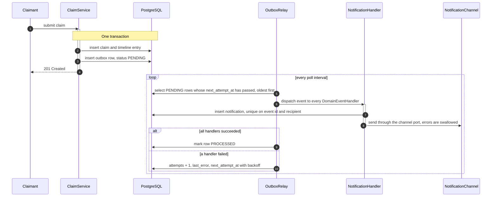
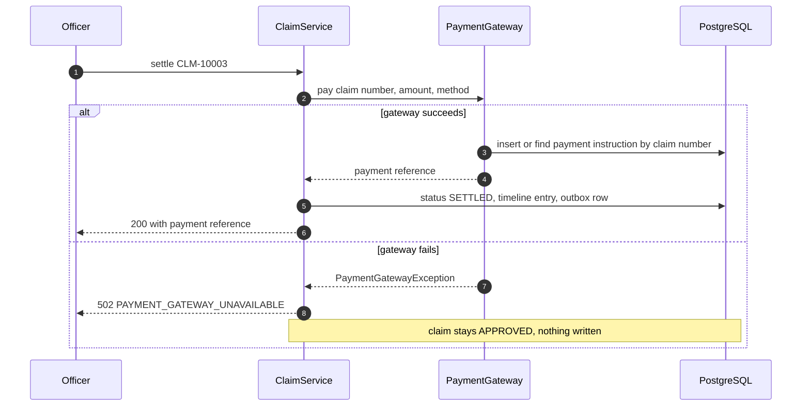

# 05. Integration Design

Status: **Planned** (outbox, relay, handlers and adapters are built in the integration prompt).
Date: 2026-10-25. Source of truth: [PROJECT_SPEC.md](PROJECT_SPEC.md) sections 3 and 8.

## 1. Two kinds of integration

| Kind | Direction | Used for | Mechanism |
|---|---|---|---|
| Asynchronous domain events | Inside the application, between modules | Telling other modules that a claim changed (notifications) | Transactional outbox plus a scheduled relay |
| External systems | Platform to outside | Policy data, payments, notification delivery | Ports owned by the module that needs them, one simulated adapter per port |

No message broker is used in this version ([ADR 0005](adr/0005-transactional-outbox-no-message-broker.md)).

## 2. Event catalogue

Events are raised by the `claim` module through `DomainEventPublisher` (a contract in `shared`, implemented in `integration`). All events have `aggregateType` `"Claim"` and the claim number as `aggregateId`.

| Event | Trigger | Payload fields beyond the common set | Consumed by (notification rule) |
|---|---|---|---|
| `ClaimSubmitted` | Claimant submits a claim | `claimedAmount`, `currencyCode` | Acknowledgement to the claimant; "new claim in the queue" to every active officer of the market |
| `ClaimAssigned` | An officer picks up a claim, or a manager assigns it | `assignedOfficerUserId` | The claimant |
| `InformationRequested` | Staff create an information request | none | The claimant |
| `InformationProvided` | Claimant responds to a request | `assignedOfficerUserId` | The assigned officer |
| `ClaimEscalated` | Officer escalates | none | Every active manager, and the claimant with a neutral message |
| `ClaimApproved` | Officer or manager approves | `approvedAmount`, `currencyCode` | The claimant |
| `ClaimRejected` | Officer or manager rejects | `reasonCode` | The claimant (message includes the reason) |
| `ClaimSettled` | Settlement succeeds | `settledAmount`, `currencyCode`, `paymentReference` | The claimant (message includes the payment reference) |

The **common payload set** is: claim number, claim type, status, market code, claimant user id, assigned officer user id (when set). Amounts and currency and the reason code are added only where relevant, as in the table. The specification's payload list does not name `paymentReference`; `ClaimSettled` carries it because the notification must quote it, and the integration prompt confirms this.

Reassignment by a manager writes an internal `REASSIGNED` timeline entry and raises **no** event, because the claimant must not see it (open question 6 in [01-problem-analysis.md](01-problem-analysis.md)).

### Envelope

Every outbox row stores this JSON envelope in `payload`:

```json
{
  "eventId": "6f1c1b0e-8c0f-4a53-9a43-5d0d7d3c2b11",
  "eventType": "ClaimApproved",
  "aggregateType": "Claim",
  "aggregateId": "CLM-10003",
  "occurredAt": "2026-10-25T05:20:31Z",
  "version": 1,
  "payload": {
    "claimNumber": "CLM-10003",
    "claimType": "MOTOR",
    "status": "APPROVED",
    "marketCode": "IN",
    "claimantUserId": "claimant.in",
    "assignedOfficerUserId": "officer.in",
    "approvedAmount": 43500.00,
    "currencyCode": "INR"
  }
}
```

`version` is the schema version of the envelope (1). A consumer that sees a higher version it does not understand must not guess.

## 3. Outbox design

The service layer never calls handlers directly. It writes the event to the `outbox_events` table inside the same database transaction that changes the claim.



Parts of the design:

- **Publisher.** `DomainEventPublisher` is implemented in `integration`. It serialises the envelope and inserts a `PENDING` row. It must run inside the caller's transaction, so a rollback removes both the state change and the event.
- **Relay.** A `@Scheduled` component, switched by `app.outbox.relay.enabled`, polling every `poll-interval-ms` (1000 ms by default) and loading at most `batch-size` (50) `PENDING` rows with `next_attempt_at` in the past, in order. It dispatches each row to **all** `DomainEventHandler` beans and then marks it `PROCESSED`.
- **Testability.** The relay exposes a method that processes exactly one batch, so tests call it directly. In the `test` profile the scheduler is switched off.
- **Handlers.** Beans implementing `DomainEventHandler` from `shared`. The `notification` module has one; `claim` and `integration` know nothing about it.

## 4. Delivery guarantees

- **At least once.** A row becomes `PROCESSED` only after every handler has returned. If the application stops between the dispatch and the update, the event is delivered again after restart.
- **Ordering.** Rows are processed in order within a single relay instance. A retry of a failed row can be overtaken by later rows. Handlers must not rely on strict ordering across events.
- **Idempotent consumers.** A duplicate delivery must have no extra effect. The notification handler inserts with a unique key `(source_event_id, recipient_id)` and ignores a duplicate. Any future handler must define its own idempotency rule ([ADR 0006](adr/0006-at-least-once-delivery-idempotent-consumers.md)).
- **Single relay instance.** Scaling out needs `SELECT ... FOR UPDATE SKIP LOCKED` (section 8).

## 5. Retry and failure handling

| Case | Behaviour |
|---|---|
| A handler throws | The relay increments `attempts`, stores a truncated message in `last_error`, and sets `next_attempt_at` to now plus an exponential delay: 2, 4, 8 seconds, and so on (2 to the power of `attempts`) |
| `attempts` reaches `app.outbox.relay.max-attempts` (5) | The row becomes `FAILED` and is no longer retried. It stays in the table for diagnosis; re-queueing is a manual database action in this version |
| Notification channel fails | The logging adapter never fails the handler, so a channel problem does not cause an outbox retry |
| A poison event (a payload that cannot be read) | Treated as a handler failure: retried with backoff and then `FAILED`. It does not block later rows |
| Payment gateway fails during settlement | Not an outbox concern. See section 6: the response is 502, the claim stays APPROVED, and no timeline entry or event is written |

## 6. Ports and adapters

| Port (owner) | Adapter (location) | Behaviour |
|---|---|---|
| `PolicyLookup` (`claim.service`) | Database snapshot adapter (`policy.infrastructure`) | Reads the local `policies` table and returns a `PolicyView`: policy number, market code, product type, holder user id, sum insured, deductible, validity dates and status. The claim module applies the validation rules |
| `PaymentGateway` (`claim.service`) | Simulated gateway (`integration.payment`) | Idempotent by claim number through the `payment_instructions` table. Returns a reference `PAY-` plus 12 upper-case hexadecimal characters. With `app.integration.payment.simulate-failure=true` it throws `PaymentGatewayException` |
| `NotificationChannel` (`notification.service`) | Logging email channel (`notification.infrastructure`) | Writes one INFO line with a masked email address. It never fails the handler |

### Settlement through the payment port

The gateway is called **before** the claim change is committed. The adapter is idempotent by claim number, so a retry returns the same reference and never pays twice.



The gateway call and the claim update are two separate resources, so a failure between them cannot be rolled back as one unit. With a real provider, the payment would already exist at the provider while the claim is still `APPROVED`. The simulated adapter models this by recording the instruction in its own transaction (a design choice that the integration prompt confirms). The retry then finds the instruction by claim number, receives the same reference, and completes the settlement without paying twice. This is why the adapter's idempotency is a requirement and not an optimisation.

### Why these three are ports

Each describes something the platform needs but does not own. Placing the interface in the module that needs it, and the adapter in the module that knows the outside system, keeps `claim` free of dependencies on `policy`, `integration` and `notification`.

## 7. Seam for a message broker

If a second system must consume claim events, the change is confined to one place: **the relay's dispatch step**.

1. Services keep calling `DomainEventPublisher`. Nothing in `claim` changes.
2. The outbox row and its envelope stay as they are; the envelope already carries `eventId`, `eventType`, `aggregateId`, `occurredAt` and `version`.
3. In the relay, replace "call every `DomainEventHandler`" by "publish the envelope to a broker topic, keyed by `aggregateId`", and mark the row `PROCESSED` only after the broker acknowledges it.
4. Run the notification handler as a consumer of that topic. It already deduplicates by `(source_event_id, recipient_id)`, so redelivery from the broker is safe.
5. Keep the in-process dispatch behind a property if a single-process mode is still wanted.

## 8. Scaling the relay

One relay instance is assumed. With several application instances, two relays could pick up the same row and send duplicate events. The fix is to select due rows with `FOR UPDATE SKIP LOCKED` (PostgreSQL) so each relay locks a different batch. It is not built because the tests run on H2 in PostgreSQL mode and the load does not need it.
