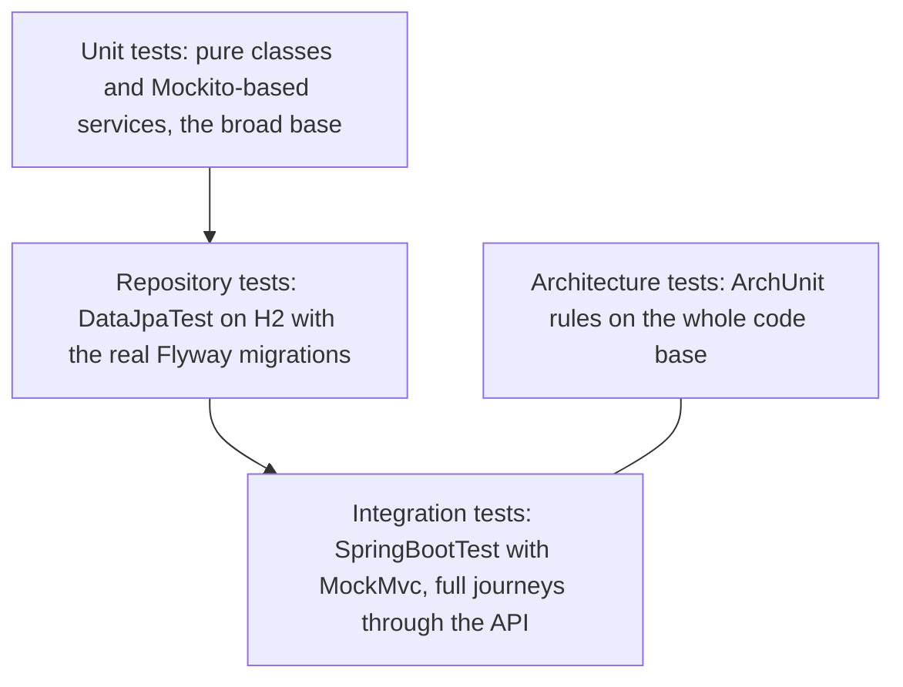

# 06. Test Strategy

Status: **Planned** (no tests exist yet; each prompt adds the tests for its stage and fills in the test names in [requirements-traceability.md](requirements-traceability.md)).
Date: 2026-10-25. Source of truth: [PROJECT_SPEC.md](PROJECT_SPEC.md) section 13.

## 1. Principles

- Every test runs on **H2 in PostgreSQL mode** (profile `test`) with no Docker and no running PostgreSQL ([ADR 0012](adr/0012-test-strategy-h2-postgresql-mode.md)). The same Flyway migrations run against H2.
- No `@Transactional` on tests: the code under test controls its own transactions, and an enclosing test transaction would hide commit-time behaviour such as the outbox and optimistic locking. The one exception is the repository tests: `@DataJpaTest` rolls each test back, which keeps them independent and lets them read lazy associations. They use their own in-memory database (`claims_repo_test`, same H2 settings), so the reference data stays exactly as migration V6 left it even when other test classes commit rows to `claims_test`. Tests that must see committed behaviour use `@SpringBootTest` and an explicit `TransactionTemplate` where they need a transaction.
- Each test creates unique data, so tests do not depend on order. Claim numbers are matched with regular expressions (`^CLM-\d{5,}$`, `^CLP-\d{5,}$`), never hard-coded.
- Tests log in through the real login endpoint to obtain tokens, so the security chain is exercised.
- A check is never weakened or deleted to make a build pass. If an architecture rule cannot be met cheaply, a narrow exception is documented in an ADR.

## 2. Test pyramid



| Level | Scope | What it proves |
|---|---|---|
| Unit | `ClaimWorkflow` (every allowed and forbidden transition), `MoneyRules`, assessment payout calculation, SLA and aging calculations, event envelope serialisation, services with Mockito for ports (for example a `PaymentGateway` failure keeps the claim APPROVED) | Rules are correct in isolation and fast to run |
| Repository | `@DataJpaTest` with `@AutoConfigureTestDatabase(replace = NONE)` and profile `test`: constraints, queries, and that the Flyway migrations validate against the entities | Schema and mapping agree; unique, check and foreign-key constraints work |
| Integration | `@SpringBootTest` with `@AutoConfigureMockMvc`: journeys through the API | The modules work together, including security and the error contract |
| Architecture | ArchUnit | The module and layer rules in the design hold, and keep holding |
| Smoke (outside Maven) | `scripts/SmokeTest.java` against a running instance | The packaged application works end to end, locally and in Docker Compose |

### Integration test topics

End-to-end journeys; security (401, 403, 404); validation and the error contract (including `AccessDeniedException` returning 403, not 500); idempotency key; pick-up race (the second pick-up gets 409); information request round trip; escalation and manager decision; settlement and gateway failure; outbox relay and idempotent notification delivery (the relay's one-batch method is called directly); reporting scope and numbers; OpenAPI content (`bearerAuth`, login `role` enum with three values, `/api/v1/claims/queue`); the literal route `/claims/queue` winning over `/claims/{claimNumber}`; and the contract test comparing the committed `src/main/resources/openapi/claims-api.yaml` with the live `/v3/api-docs` (same paths and methods in both directions).

### Architecture rules

- Layer rules inside modules.
- Modules are free of cycles.
- No module depends on another module's `api` or `infrastructure` package.
- `claim` does not depend on `policy`, `notification`, `reporting` or `integration`.
- `domain` does not depend on `org.springframework.web`, `jakarta.servlet`, or any `api`, `service` or `infrastructure` package.
- `security` depends on no feature module.
- No field injection; controllers are `@RestController` classes in `..api..` named `*Controller`.
- No standard streams, no `java.util.logging`, no generic exceptions (ArchUnit `GeneralCodingRules`).

## 3. Tools

| Tool | Use |
|---|---|
| JUnit 5 | Test engine (through `spring-boot-starter-test`) |
| Mockito | Mocks for ports in service unit tests |
| Spring Boot Test, MockMvc, `spring-security-test` | Integration tests through the real security chain |
| H2 in PostgreSQL mode | Database for all tests: `jdbc:h2:mem:claims_test;MODE=PostgreSQL;DATABASE_TO_LOWER=TRUE;DEFAULT_NULL_ORDERING=HIGH;DB_CLOSE_DELAY=-1` |
| ArchUnit (`archunit-junit5` 1.3.0) | Architecture rules |
| JaCoCo 0.8.12 | Coverage report; the `check` rule is added in the reporting prompt |

`@MockBean` is not used (it is deprecated in Spring Boot 3.4 and later); tests use `@MockitoBean` where a bean must be replaced.

## 4. Quality gates

| Gate | Threshold | Enforced by |
|---|---|---|
| Build and tests | `mvnw -B clean verify` is green on JDK 21 | Maven |
| Line coverage | At least 75% for the bundle, excluding DTO records, `config`, the main class and `package-info` | JaCoCo `check` rule (added in the reporting prompt) |
| Test count | At least 80 test methods in total | Counted during the final verification |
| Architecture | All ArchUnit rules pass | The ArchUnit test class, part of `verify` |
| Contract | Committed OpenAPI file and live API document agree | A dedicated integration test |
| Working tree | `git status` is clean after each stage | Checked by hand at the end of each prompt |

## 5. How to run everything

Use JDK 21 (`JAVA_HOME` pointing to it) and the Maven Wrapper. In PowerShell or cmd:

```
.\mvnw.cmd -B clean verify
```

In Git Bash: `./mvnw -B clean verify`.

| Goal | Command |
|---|---|
| Whole build with tests and the coverage report | `.\mvnw.cmd -B clean verify` |
| Tests only | `.\mvnw.cmd -B test` |
| One test class | `.\mvnw.cmd -B test -Dtest=ClaimWorkflowTest` |
| Coverage report | open `target/site/jacoco/index.html` after `verify` |
| Smoke test against a running instance (last prompt) | `java scripts/SmokeTest.java http://localhost:8080` |

The smoke script prints PASS or FAIL per step and exits with 1 on any failure. It covers health, login for each role, a wrong role (401), claim submission and idempotent replay, pick-up, assessment, information request and response, escalation, approval limit (422), manager approval, settlement, notifications, reports, scope (404) and validation (400).

## 6. What is deliberately not tested, and why

| Not tested | Reason |
|---|---|
| The `Dockerfile` and `docker-compose.yml` by running them | Docker is not installed on the development machine. They are reviewed line by line, and the journal says so |
| Behaviour that exists only on real PostgreSQL (lock timeouts, `SKIP LOCKED`) | Tests use H2 in PostgreSQL mode. The final verification runs the application against the local PostgreSQL 17, but no automated test targets it |
| Multiple relay instances | One relay instance is a documented limit |
| Performance and load | Out of scope for the assessment; no performance requirement is stated |
| A real payment, policy or email system | These are simulated behind ports; the tests cover the ports and the simulated adapters |
| A frontend or the Swagger UI rendering | No frontend exists; the OpenAPI document is tested instead of the page |
| Generated or trivial code (DTO records, configuration records, `package-info`) | No logic to test; excluded from the coverage measure |
| Time-of-day dependent behaviour with the real clock | Time-sensitive code (SLA, aging, overdue) takes a `Clock` so tests control time |

## 7. Plan by prompt

| Prompt | Tests added |
|---|---|
| 2 Data layer | Repository tests for constraints and queries, migration validation, application context test |
| 3 Security and identity | Security and error-contract integration tests, JWT tests, auth and user endpoints, OpenAPI configuration |
| 4 Claims core | `ClaimWorkflow` and payout unit tests, submission, idempotency, pick-up race, information request journey, decisions; first ArchUnit rules |
| 5 Integration | Outbox and relay tests, idempotent notifications, payment gateway adapter, settlement and failure |
| 6 Reporting | Report scope and numbers, SLA and aging unit tests; complete ArchUnit rules; JaCoCo gate |
| 7 Packaging | Contract test; smoke script run against the live application |
